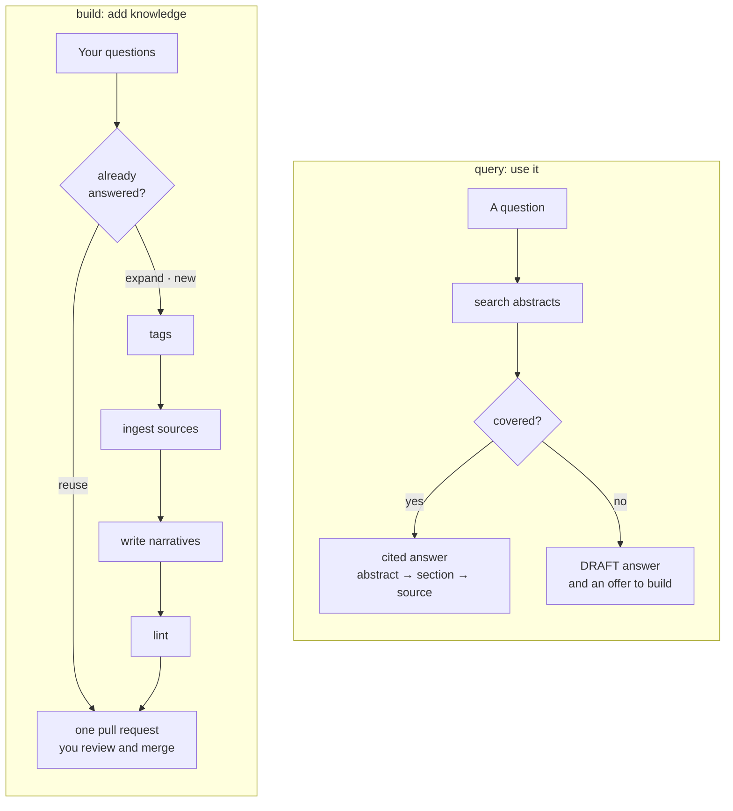

# Structural LLM Wiki

[](#setup)
[](LICENSE)
[](#requirements)

> [!NOTE]
> The skill is being rebuilt to the design below, phase by phase ([the plan](docs/skill_execution_plan.md)). Until its first release, installing it gives you an unfinished skill.

Agent skills for a Structural LLM Wiki: a team's knowledge kept in git, organized by topic tags, traced to its sources, and reviewed like code.

Inspired by Andrej Karpathy's [LLM wiki pattern](https://gist.github.com/karpathy/442a6bf555914893e9891c11519de94f), where an LLM builds and maintains a persistent, interlinked markdown wiki from raw sources. Structural LLM Wiki adds what a team needs on top of that idea: topic tags that link sources, narratives and people; every claim traced to a section of a saved source; and every change landing as a pull request someone reviews.

Most team knowledge is scattered: design docs that have drifted from the code, decisions buried in chat threads, and the rest in a few people's heads. Ask an AI assistant and you get an answer once. It's unverified, it's gone when the session ends, and it's stale by next quarter. A Structural LLM Wiki turns that into knowledge that compounds: your coding agent does the research and the upkeep, and your team reviews it.

- **Every claim is traceable.** Narratives cite the exact section of a source they rest on, and the source is saved in the wiki, so anyone can check it. What no source says is marked as the narrative's own reasoning, or as a gap.
- **Questions drive the work.** A run starts from the questions you want answered, and collects only the sources those answers need.
- **It stays current.** When a source changes, exactly the narratives built on it are flagged and rechecked.
- **You know who to ask.** Each topic lists the people who know it, drawn from git history, doc authorship and reviews, with the evidence.
- **Every change is reviewed.** Each run lands as one pull request with a review checklist; nothing merges until you tick it and merge.
- **It's frugal with tokens.** Scripts do everything mechanical, the agent reads the smallest thing that answers, and nothing is read twice.
- **It's portable.** Plain markdown and YAML in git: browse it on GitHub, open it as an Obsidian vault, maintain it with Claude Code or any agent that supports [Agent Skills](https://agentskills.io).

## How it works

A wiki is its own git repository. Its knowledge lives in `sllmwiki/`:

| Content | Where | What it is |
|---|---|---|
| **Sources** | `sllmwiki/sources/` | Docs, web pages, papers and code pointers, saved as markdown (text verbatim; a web page's main content; a PDF's text under its own chapter headings), each with its URL, date, license and a short abstract |
| **Tags** | `sllmwiki/tags/` | A tree of topics, each with a page listing its sources, narratives and the people who know it |
| **Narratives** | `sllmwiki/narratives/` | One answer per question, opening with an abstract, every claim cited |
| **Index** | `SLLMWIKI_INDICES.md` | A clickable map of the tag tree, for GitHub |

Two workflows use it: `build` adds knowledge and `query` answers from it.



**`build`** starts from your questions. For each, it first looks for a narrative that already answers it, and reuses or expands it before writing anything new. Then it maps the questions to tags, finds and saves the sources they need, writes one narrative per question from a reading plan (most relevant and authoritative sources last), and lints each narrative against the source sections it cites. Everything lands in one pull request, whose description starts with a review checklist and lists anything the run couldn't decide. The run doesn't stop to ask; you review the pull request, comment, and the agent applies your feedback on the same branch.

**`query`** answers from what the wiki already knows, reading as little as possible: narrative abstracts first, then one section, then the cited section of a source. The answer cites what it read, flags anything built on a source that has changed since, and names who to ask. It never changes the wiki: when an answer had to be stitched together, it offers to file it as a narrative; when the wiki doesn't cover the question, it answers anyway, labeled DRAFT, and offers to `build` it.

## Setup

### Requirements

| Tool | Needed for | |
|---|---|---|
| An agent that runs [Agent Skills](https://agentskills.io), such as [Claude Code](https://docs.claude.com/en/docs/claude-code) | running the skill | required |
| git | history, branches and commits | required |
| Python 3.9 or later | the skill's scripts (standard library only) | required |
| [`gh`](https://cli.github.com), signed in | creating the wiki's remote and opening pull requests; without it, the skill prints the link to open each one yourself | recommended |

```bash
brew install git python gh                                   # macOS
winget install Git.Git Python.Python.3.13 GitHub.cli         # Windows
sudo apt-get install -y git python3 gh                       # Debian / Ubuntu
gh auth login && gh auth setup-git                           # then, everywhere
```

### Start a wiki (once, by one person)

1. Create an empty repository (for example `project-foobar-sllmwiki`), clone it and start Claude Code in it.
2. Install the plugin into it:

   ```bash
   claude plugin marketplace add mengjiasun1992/structural-llm-wiki --scope project
   claude plugin install sllmwiki@structural-llm-wiki --scope project
   ```

3. Run `/sllmwiki:init`. It lays out the wiki, installs its CI checks and makes the first commit.
4. Ask your first questions: `/sllmwiki:build "How does our gateway route requests? Why does it retry?"`

### Join a wiki

Clone it and start Claude Code inside. Trust the folder, and accept the `sllmwiki` plugin the repository offers.

### Other agents

Codex, Cursor, Copilot and other agents install the skill with the [`skills` CLI](https://skills.sh): `npx skills add mengjiasun1992/structural-llm-wiki -g`. There are no commands there; ask for what you want in your own words ("lint the gateway narratives").

## Usage

| I want to… | Run |
|---|---|
| Get an answer from the wiki | `/sllmwiki:query "How does the gateway retry failed backends?"` |
| Research questions and add the answers | `/sllmwiki:build "How does the gateway route requests?"` |
| Answer one question from sources already saved | `/sllmwiki:narrative "Why does the gateway retry failed backends?"` |
| Add a source, or refresh changed ones | `/sllmwiki:ingest gateway "the retry policy design doc"` |
| Check a narrative, or a whole topic | `/sllmwiki:lint gateway` |
| Find who to ask | `/sllmwiki:smes gateway` |
| See which topics a question belongs to | `/sllmwiki:tags "gateway vs load balancer"` |

**Reviewing.** Each run's pull request starts with a checklist (tags, sources, each narrative). Tick each box as you check it; the wiki's "Review checklist" check turns green when all are ticked. Leave comments, and ask the agent to "apply the review comments on PR #12".

**Narrative templates.** The skill picks the template that fits the question: `concept_brief_overview` ("What is X?"), `technical_brief_overview` ("How does X work?"), `comparison` ("X vs Y"), `survey` ("What are the principles of X?") or `case_study` ("What happened in this incident, and what does it teach?"). Each comes with a writing guide for a reader new to the topic. Bring your own by adding a folder with a `template.md` and a `guide.md` to the wiki's `templates/`; a folder named like a bundled template replaces it.

**Markers.** What no source states is marked `[->]` (our own reasoning), and something the sources don't answer `[?]`, after the statement like a citation, or once on a heading for a whole section; each narrative defines the ones it uses. Turn them off with `markers = false` (see below).

**Settings.** A wiki can keep an optional `Config.toml` (`init` writes it with the defaults):

```toml
[structural-llm-wiki-settings]
source_copies = "allow"     # or "links-only": keep no copies, only links
max_quote_words = 50        # the longest quotation a narrative may take
smes_exclude = []           # never listed as SMEs, such as the wiki's owner or bots
markers = true              # false: no reasoning or gap markers
images = true               # false: diagrams in mermaid only, no generated figures

[structural-llm-wiki-templates.technical_brief_overview]
max_words = 3000            # a template's word budget, over its own

[structural-llm-wiki-addons]
obsidian = false            # true: set the wiki up to open as an Obsidian vault
```

**Obsidian.** With `obsidian = true` and `/sllmwiki:init` rerun, open `sllmwiki/` as a vault: tags, narratives and sources form one graph, colored by kind.

**Source policy.** The wiki keeps copies of other people's work, so the skill follows a policy: copyright stays with the authors; every source keeps its URL and license; narratives quote briefly; logins and paywalls are never bypassed; a private wiki keeps reference copies unless a source's terms forbid it, and a public wiki only openly licensed ones; no personal data or secrets. The scripts enforce what they can, and the wiki's CI fails on a copy a public wiki may not hold. It's a cautious default, not legal advice.

## Design

[docs/structural_llm_wiki_design.md](docs/structural_llm_wiki_design.md) has the architecture and the decisions behind it; [docs/skill_execution_plan.md](docs/skill_execution_plan.md), how it's being built.

## Developing

```text
src/
├── skills/sllmwiki/   the skill: SKILL.md, workflows/, steps/, scripts/, templates/, tests/, evals/
├── commands/          Claude Code commands, one per workflow and step
├── actions/           the GitHub actions a wiki's CI calls
└── tools/             CI tools outside the skill (check-yaml)
docs/                  the design and the plan
```

`AGENTS.md` has the rules for changing this repository: tests with every logic change and coverage at 95% or above, instruction word budgets, evals for behavior changes. Run the tests, and try the plugin from a checkout:

```bash
python3 -m pip install "coverage[toml]==7.6.10"
python3 src/skills/sllmwiki/tests/run.py --coverage
claude --plugin-dir .
```

## License

[Apache 2.0](LICENSE)
