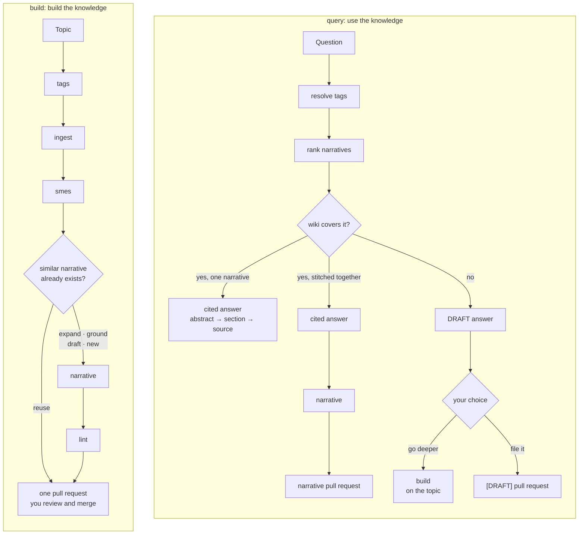

# Structural LLM Wiki

[](#setup-guide)
[](LICENSE)
[](#requirements)

Agent skills for a structural LLM wiki: knowledge kept in git, organized by topic tags, traced to its sources, and versioned like code.

Inspired by Andrej Karpathy's [LLM wiki pattern](https://gist.github.com/karpathy/442a6bf555914893e9891c11519de94f), where an LLM incrementally builds and maintains a persistent, interlinked markdown wiki from raw sources. Structural LLMWiki adds the structure a team needs on top of that idea: topic tags that link sources, narratives and people; every claim traced to a saved source; and every change landing as a reviewable pull request.

Most team knowledge is scattered: design docs that have drifted from the code, decisions buried in chat threads, and the rest in a few people's heads. Ask an AI assistant and you get an answer once. It's unverified, it's gone when the session ends, and it's stale by next quarter.

A structural LLM wiki turns that into a knowledge base that compounds. Your coding agent does the research and the upkeep; your team reviews it like code.

- **Every claim is traceable.** Narratives cite the exact sources they're built on, and those sources are saved verbatim in the repo, so anyone can check a claim. Lint flags any claim that no source supports.
- **Reading is planned around the model's attention.** Hierarchical topic tags link sources, narratives, and people into a topic graph. Before writing, the agent uses that graph to order its reading by relevance, then authority, then date: related narratives first for background, supporting sources next, and the most relevant, most authoritative and newest sources last, where attention is strongest. Parent and neighboring topics are noted but not read, so the context stays focused.
- **Conflicts surface as understanding deepens.** Each narrative is checked against its sources and against every narrative that shares its tags. As you dig deeper, lint catches new findings that contradict earlier answers, new neighboring topics worth linking, and narratives that describe the design rather than what the code actually does.
- **Knowledge stays current.** Every source carries a timestamp and a hash. When one changes, the wiki knows which narratives depend on it and re-checks them, instead of letting them quietly go stale.
- **You know who to ask.** For each topic, the wiki lists the people who actually know it, drawn from git history, doc authorship, and code reviews, each with a specific question to ask them.
- **Every change has lineage.** Each run lands as one pull request that records what was read, what was skipped, and why. You can trace how the team's understanding evolved and roll back any step.
- **Explore it as a graph in Obsidian.** Turn on the Obsidian add-on and open the wiki's content folder as an [Obsidian](https://obsidian.md) vault: tags, narratives and sources become one interactive knowledge graph, with a page per tag, each narrative's tags in Obsidian's tag pane, and colors by kind. The markdown is kept to what GitHub and Obsidian render the same way, so the wiki reads the same in both.
- **It's portable.** The whole wiki is plain markdown and YAML in git, with no database and no lock-in. Clone it anywhere, browse it on GitHub, and maintain it with Claude Code, Codex, or any agent that supports Agent Skills.

This repo holds one skill, `sllmwiki`: two workflows (build and query) made of five steps. Each wiki lives in its own repository. The skill follows the [Agent Skills](https://agentskills.io) format, so they work in Claude Code, Codex, and other agents that support it.

## How the workflows work together

A wiki has four kinds of content, all plain files in its repository:

| Content | Where | What it is |
|---------|-------|------------|
| **Sources** | `ingested/` + `ingested/manifest.yaml` | Verbatim copies of docs, web pages, papers and code pointers, all saved as markdown, each with its URL, dates, hash and a 150–250 word abstract (the source's own abstract when it has one) |
| **Topic tags** | `tags.yaml` | A set of topic trees; each tag lists its sources, narratives and people (SMEs), with a 150–250 word abstract rolled up from its narratives and sub-tags |
| **Narratives** | `groomed/` + `groomed/manifest.yaml` | One answer per question, opening with a 150–250 word abstract (also kept in the manifest), every claim cited, with a numbered link, to a saved source, pinned to the versions it was built from |
| **Index** | `SLLMWIKI_INDICES.md` | A generated, clickable map of topics and narratives, plus a table of every narrative |

Two workflows use that content: `build` builds it and `query` answers from it. They're made of five steps, each of which also runs on its own:



**Building (`build`)** runs the steps in order and lands everything in one pull request:

1. **`tags`** matches the topic to existing tags, proposes new ones, and flags sources whose originals have changed.
2. **`ingest`** searches for sources (authoritative and recent first) and saves each one verbatim as markdown, whatever its format: HTML pages are converted, PDFs are extracted with their headings, and markdown and plain text are kept byte for byte. It downloads their images, ends each file with its original URL, and records the source in the manifest and on its tags.
3. **`smes`** finds the people behind the tagged code and docs, with evidence and a question to ask each.
4. **Reuse before writing.** For each question you ask, the workflow first looks for a narrative that already covers it and proposes to **reuse** it (no new narrative), **expand** it (wider scope or new sources, new version), **ground** it if it's a DRAFT, or write a **new** one only when the question is genuinely different.
5. **`narrative`** plans its reading from the tag graph (relevance, then authority, then date), reads, and writes or updates the narrative, where every claim cites a source.
6. **`lint`** checks the narrative against its sources and every narrative sharing its tags, fixes small problems one commit at a time, and hands bigger ones to you.
7. **The pull request** records the whole run: the tag resolution, the sources found and ingested, the SMEs, the reuse decisions, the reading plan, the narrative's outline and every lint finding. You review it: check that the tag resolution is right, that the sources are the ones you'd trust, and that the narrative reads well and follows the format. Then leave specific feedback as PR comments. The agent addresses them on the same branch ("apply the review comments on PR #12"), and you merge when it's right.

**Querying (`query`)** answers a question from what the wiki already knows, for a person or for another agent, reading as little as possible. It resolves the question to tags, ranks the narratives under them, and works down the tiers, stopping at the first that answers: the tag abstract, narrative abstracts, one narrative section, the cited source section (a citation link opens just that section), then sources no narrative covers yet. The answer cites what it rests on, flags narratives built on sources re-ingested since, and names who to ask. A typical answer reads a few kilobytes. An answer one narrative gives changes nothing. When the answer had to be stitched together from several narratives, or from sources no narrative covers, it's filed as a new narrative in a pull request, so the synthesis isn't lost. When nothing covers the question, you still get an answer, marked **DRAFT** (anything the wiki's sources don't support is labeled as inference), and then you choose: **go deeper**, and it runs `build` on the topic to research and ground it properly; **file it** as a draft narrative in a `[DRAFT]` pull request if it's good enough for now; or leave it. It never starts research on its own.

**Initializing (`init`)** creates the wiki once and keeps its layout current: it lays out the folders and files, installs the CI checks, and, when you change a path or a setting in `Config.toml`, moves the files and rewrites what points at them.

Underneath, the workflows share a few deterministic scripts (Python, standard library only): `fetch-source` saves sources exactly, `manifest` records sources and narratives (`put-manifest` writes a narrative's entry from the file itself), `wiki-check` keeps manifests, tags and `SLLMWIKI_INDICES.md` consistent, `narrative-format` checks a narrative's structure, `tag-tree` and `search` answer questions about the tree and find what to read, and `publish.sh` runs the branch-and-PR flow.

**What keeps it honest and current:**

- **One pull request per run.** Its description starts with a review checklist, and the wiki's "Review checklist" check stays red until you tick every box. Nothing merges without you.
- **The same checks in CI.** Every wiki PR runs `wiki-check` (including a schema check of `tags.yaml` and both manifests: required fields, no unknown or misspelled ones, value types and allowed values), `narrative-format`, a YAML check and markdownlint, straight from this repository.
- **Staleness flows downstream.** `check-upstream` notices when an original changes; re-ingesting it marks the narratives pinned to the old version, and lint re-checks them.
- **Tag abstracts stay current.** When a narrative is added or changed, `narrative` and `lint` rewrite the abstract of each tag it belongs to, and the change rolls up through the parent tags to the root, so every topic's summary reflects what the wiki now knows.

## Setup guide

### Requirements

| Tool | Needed for | |
|---|---|---|
| An agent that runs [Agent Skills](https://agentskills.io), such as [Claude Code](https://docs.claude.com/en/docs/claude-code) | running the skill | required |
| git | history, branches, and commits | required |
| Python 3.9 or later | the scripts bundled with the skill (standard library only, no packages) | required |
| [`gh`](https://cli.github.com), signed in | installing the plugin from this repo, creating the wiki's remote, and opening pull requests; without it the workflows print the link to open each PR yourself | recommended |

Install them with your platform's package manager:

```bash
# macOS (Homebrew: https://brew.sh)
brew install git python gh   # or Python from https://www.python.org/downloads/

# Windows
winget install Git.Git Python.Python.3.13 GitHub.cli

# Debian / Ubuntu
sudo apt-get install -y git python3 gh

# then, on every platform
gh auth login
gh auth setup-git
```

Every workflow checks for these when it starts (`preflight.sh`), stops if git or Python is missing, and prints the install command for this machine.

### How installation works

There are two kinds of repository:

- **This repo** holds the skill. You never clone it by hand: installing the plugin downloads it for you.
- **A wiki repo** holds one wiki's content. You create it once, and your team clones it like any other repo.

The plugin is installed **into the wiki repo** (project scope), so the setting is committed with the wiki and everyone who opens that repo gets the same skill.

To install, your GitHub account needs read access to this repo, and git on your machine must be able to fetch from GitHub as that account. The installer clones over SSH (`git@github.com:…`) and falls back to HTTPS. The simplest init:

```bash
gh auth login        # sign in as the account that can read this repo
gh auth setup-git    # let git use that sign-in for HTTPS
```

If the install fails with "Repository not found", your default SSH key probably belongs to a different GitHub account. `gh auth setup-git` fixes it, because the HTTPS fallback then uses your `gh` sign-in. The installer ignores SSH host aliases from `~/.ssh/config`.

### Set up a new wiki repo (once, by one person)

#### 1. Create an empty repository and open it

Create an empty repository on your git host (for example, `project-foobar-sllmwiki` on GitHub), clone it, and start Claude Code inside it:

```bash
git clone git@github.com:<you>/project-foobar-sllmwiki.git
cd project-foobar-sllmwiki
claude
```

You can also start in an empty local folder; step 3 will run `git init` and offer to create the remote.

#### 2. Install the plugin into this repo

From the repo folder, in your shell:

```bash
claude plugin marketplace add mengjiasun1992/structural-llm-wiki --scope project
claude plugin install sllmwiki@structural-llm-wiki --scope project
```

This writes `.claude/settings.json` in the repo. The workflows appear in Claude Code as commands: `/sllmwiki:init`, `/sllmwiki:narrative`, and so on. (Run `/reload-plugins`, or restart Claude Code, if they don't show up yet.)

#### 3. Run the one-time `init`

```text
/sllmwiki:init
```

It creates the wiki layout, makes the first commit (including `.claude/settings.json` from step 2), and pushes it, or offers to create the remote:

```text
<wiki-repo>/
├── README.md                 # what this wiki is and how to use it
├── SLLMWIKI_INDICES.md       # generated map of topics and narratives (click a narrative to open it)
├── AGENTS.md                 # rules for agents working in this repo
├── CLAUDE.md                 # imports AGENTS.md for Claude Code
├── .gitignore
├── .claude/settings.json     # offers the sllmwiki plugin to teammates (Claude Code)
├── .github/workflows/        # review-checklist.yml: red until a run PR's review boxes are ticked
│                             # wiki-checks.yml: checks manifests, narratives, YAML and markdown on every PR
├── Config.toml               # where the wiki keeps its files, and the skill's settings
├── templates/                # the wiki's own narrative templates
└── sllmwiki/                 # the content folder: the knowledge, Obsidian's vault, the books' source
    ├── tags/
    │   ├── tags.yaml         # hierarchical topic tags
    │   └── <tag>.md          # a page per tag, with the Obsidian add-on
    ├── ingested/             # sources, saved verbatim
    │   ├── manifest.yaml     # source registry
    │   └── images/
    └── groomed/              # narratives, one per question
        └── manifest.yaml     # narrative registry
```

`init` is safe to rerun: it only adds what's missing. The wiki's two workflows call actions in this repository (`src/actions/wiki-checks`, `src/actions/review-checklist`), so the wiki keeps no copy of the checks and its CI always runs the current ones. While this repository is private, set its Settings → Actions → General → Access to "Accessible from repositories owned by" your account, or the wiki's checks can't load the actions.

#### 4. Repository settings (optional)

Each run opens one pull request against the default branch for you to review and merge. Turn on "Automatically delete head branches" in your repository settings so merged run branches clean themselves up. Requiring a pull request before merging is optional.

#### 5. Build your first topic

```text
/sllmwiki:build "how our request routing works"
```

The pipeline resolves tags, ingests sources, finds SMEs, asks which questions you want answered, writes and lints a narrative for each, and opens one pull request you can watch fill in as it runs, then review and merge.

### Join an existing wiki (everyone else)

1. Clone the wiki repo and start Claude Code inside it.
2. When Claude Code asks whether to trust the folder, say yes. It then offers to install the `sllmwiki` plugin that the repo declares; accept.
3. Start working, for example `/sllmwiki:narrative "<question>"`.

No `init` step: the wiki already exists.

### Other ways to install

**For all your projects (user scope).** If you work across several wiki repos and want the skill everywhere, install once without `--scope`:

```bash
claude plugin marketplace add mengjiasun1992/structural-llm-wiki
claude plugin install sllmwiki@structural-llm-wiki
```

**Codex, Cursor, Copilot, and other agents.** These don't use Claude Code plugins. The open-source [`skills` CLI](https://skills.sh) detects your installed agents and copies the skills into each one's skills folder:

```bash
npx skills add mengjiasun1992/structural-llm-wiki -g
```

Outside Claude Code's plugin system there are no commands: the skill is installed as `sllmwiki`, and you ask for a workflow in your own words ("narrate: why does the gateway retry?", "lint the gateway narratives"). Teammates on these agents install the skill themselves; the wiki repo's `.claude/settings.json` only prompts Claude Code users.

**Manually.** Clone this repo and symlink `src/skills/sllmwiki` into your agent's skills folder, for example `~/.claude/skills/` for Claude Code or `~/.agents/skills/` for Codex.

**Updating.** Claude Code refreshes plugins from GitHub; to update right away, run `claude plugin update sllmwiki`.

## Usage guide

**Calling a workflow.** In Claude Code, type the command (`/sllmwiki:<workflow>`), pick it from the `/` menu, or just describe what you want ("lint the gateway narratives") and Claude picks the workflow. On other agents, describe what you want, or name the workflow ("run the narrative step for …").

**Reviewing.** Every run that changes the wiki ends in one pull request against the default branch, never stacked on another PR. Its description starts with a review checklist naming what to check (tags, sources, each narrative); tick each box as you go, and the wiki's "Review checklist" check turns green when all are ticked. Then merge it; anything the run couldn't decide on its own (for example, a narrative that new sources say should be rebuilt) is listed at the top. To apply feedback, ask the agent to work on the same branch, for example "apply the review comments on PR #12". The PR is updated rather than replaced.

### Common tasks

| I want to… | Run |
|---|---|
| Get an answer from what the wiki already knows | `/sllmwiki:query "How does the gateway retry failed backends?"` |
| Understand a new topic from scratch | `/sllmwiki:build "how the gateway routes requests"` |
| Answer a new question from sources already in the wiki | `/sllmwiki:narrative "Why does the gateway retry failed backends?"` |
| Pull in a new doc, or refresh sources that changed | `/sllmwiki:ingest gateway "new retry policy design doc"` |
| Check a narrative before trusting it | `/sllmwiki:lint what-is-gateway.md` |
| Check that everything about a topic is consistent | `/sllmwiki:lint gateway` |
| Find out who to ask | `/sllmwiki:smes gateway,routing` |
| See which topics a question belongs to | `/sllmwiki:tags "gateway vs load balancer"` |

### Exploring the wiki in Obsidian

[Obsidian](https://obsidian.md) draws a vault as a graph: every markdown file is a node, every link an edge. The Obsidian add-on makes a wiki's topic structure part of that graph.

1. In the wiki's `Config.toml`, set `enabled = true` under `[structural-llm-wiki-settings.addons.obsidian]`, then run `/sllmwiki:init`.
2. In Obsidian, choose **Open folder as vault** and pick the content folder (`sllmwiki/`).
3. Open the graph view. Tag pages (indigo) form the topic tree, with each tag's narratives (blue) around it.

What the add-on generates and keeps current:

- **A page per tag**, next to `tags.yaml`: its description and abstract, its parent and subtags, its narratives and sources, and its SMEs. The links put the tag tree in the graph, and on GitHub each page is a topic to browse.
- **A header on each narrative** with its tags as Obsidian tags (full paths, such as `algorithms/moving-averages/ewma`), its version and its last update, for the tag pane and `tag:` searches.
- **Default graph settings** (`.obsidian/graph.json` in the vault), written once: colors by kind, and sources hidden. `show_sources = true` shows them in grey. Edit the file as you like; `init` never overwrites it, and runs ignore Obsidian's changes to it.

The settings: `show_sources` (default `false`), and `vault`, the folder you open: `"content"` (default) shows only the knowledge, `"root"` the whole repository, with the files that run the wiki filtered out. Narratives stick to markdown both GitHub and Obsidian render the same way (no wikilinks, `%20` for spaces in links, `$$` math), and `obsidian-check` keeps every other page to it in CI. Sources are never changed: they join the graph through citations and tag pages.

### Reference

**Workflows**

#### `build` — build up a topic end to end

The main way to build. Resolves tags, ingests sources, finds SMEs, and asks which questions you want answered. For each question it first looks for a narrative that already covers it and proposes to reuse, expand or ground it, writing a new one only when the question is genuinely different. Then it writes or updates and lints the narratives. Everything lands in one pull request that fills in as the run progresses.

```text
/sllmwiki:build "how the gateway routes requests"
/sllmwiki:build "load balancer vs rate limiter"
```

#### `query` — answer from the wiki

Answers a question from existing knowledge, reading as little as possible: tag abstracts, then narrative abstracts, then one section, then the cited source section. Cites what it used, flags anything stale, says what isn't covered, and names who to ask. When it had to stitch the answer together from several narratives or from sources no narrative covers, it files that answer as a new narrative pull request, so the synthesis isn't lost. When nothing covers the question, it answers anyway, marked DRAFT, and asks what you want next: go deeper (it runs `build` on the topic, to research and ground it), file the answer as a draft narrative in a `[DRAFT]` pull request if it's good enough, or leave it. Another agent can point it at a wiki clone with `--root`.

```text
/sllmwiki:query "How does the gateway retry failed backends?"
/sllmwiki:query "What is the CAP theorem, and what does it mean for our design?"
```

#### `init` — set up a wiki repository

Run once per wiki repo. Creates the layout, README, `AGENTS.md`, and project settings, then makes the first commit. Safe to rerun; it only adds what's missing.

```text
/sllmwiki:init
/sllmwiki:init project-foobar-sllmwiki
```

**Steps** (each also runs on its own)

#### `tags` — map a topic to tags

Shows which existing tags match, proposes new ones, classifies them as primary or supporting, and lists stale sources. It doesn't fetch anything; once you confirm, it adds any new tags to `tags.yaml`.

```text
/sllmwiki:tags "how the gateway routes requests to backends"
/sllmwiki:tags "What is LLM wiki?"
```

#### `ingest` — add or refresh sources

Searches docs, code, and chat for sources on the given tags, preferring authoritative and recent ones, saves them verbatim (PDFs as markdown), and updates the manifests. Pauses only for sources over 50KB or ones that look risky, such as docs marked confidential. Afterwards it re-lints the narratives those tags feed.

```text
/sllmwiki:ingest gateway,routing "how the gateway routes requests"
/sllmwiki:ingest load-balancer
/sllmwiki:ingest gateway "retry policy design doc: https://docs.example.com/gateway/retry-policy"
```

#### `smes` — find who knows a topic

Locates the code and docs behind the tags, then ranks people by git history, doc authorship, `CODEOWNERS`, and reviews. Each person comes with the evidence and a specific question to ask them.

```text
/sllmwiki:smes gateway
/sllmwiki:smes routing "who decided the backend selection algorithm"
```

#### `narrative` — answer one question

Plans its reading from the tag graph, sorted by relevance, then authority, then date (the most relevant, authoritative and newest last), writes a narrative where every claim traces to a source, runs lint on it, and saves it to `groomed/`. Asking the same question again updates the existing narrative to a new version.

```text
/sllmwiki:narrative "How does the gateway route requests to backends?"
/sllmwiki:narrative "What happens when a backend fails its health check?"
```

#### `lint` — check and fix narratives

Checks narratives against their sources, the code, and every narrative sharing their tags. Small fixes are applied one commit at a time; bigger ones are handed to you. Give it a narrative file, a tag, or a description.

```text
/sllmwiki:lint what-is-gateway.md
/sllmwiki:lint gateway
/sllmwiki:lint "how requests get routed"
```

### Narrative templates

Narrate picks a template that fits the question, and each template comes with its own writing guide:

| Template | For questions like |
|----------|--------------------|
| `concept_brief_overview` | "What is X?" about an idea or a whole field: an authoritative definition and the main ideas, in about 900 words |
| `technical_brief_overview` | "How does X work?" about a system: the end-to-end flow, design decisions, failure modes (the default) |
| `decision_record` | "Why does X do Y?", "Should we use X?", after Architecture Decision Records |
| `comparison` | "X vs Y": a criteria table, the differences that matter, when to choose which |
| `survey` | "What are the principles / patterns of X?": every item briefly, and how they relate |

To change them for your wiki, edit the `[structural-llm-wiki-templates]` section of the wiki's `Config.toml`. You can replace a template's skeleton or guide, change its lengths, add templates of your own, hide ones you don't use, or change the default. init registers one template of the wiki's own there already, `topic_research_record` (for recording a piece of research: the question, sources consulted, findings with their confidence, open questions), as a working example to edit or copy. Copy a bundled template's folder from the skill's `templates/narratives/` to start from it. Anything you don't configure uses the bundled version.

### Wiki layout

A wiki's `Config.toml` says where it keeps its files. `init` creates it with the defaults, and asks once during `init` whether you want other names:

```toml
[structural-llm-wiki-paths]
content = "sllmwiki"                        # the content folder; "." is the repository root
ingested = "ingested"                       # in the content folder: sources, saved verbatim
ingested_manifest = "ingested/manifest.yaml"
groomed = "groomed"                         # narratives
groomed_manifest = "groomed/manifest.yaml"
tags = "tags/tags.yaml"                     # its folder also holds the tag pages (Obsidian add-on)
index = "SLLMWIKI_INDICES.md"
templates = "templates"                     # the files of your own templates

[structural-llm-wiki-settings]
slice_large_sources = true   # save a PDF over 50 KB one section per source
```

With `slice_large_sources` on (the default), ingesting a long paper saves it one section per source, so each stays under the 50 KB limit and a narrative can cite the exact section. Sections holding an email address are left out as personal data. Set it to `false` to be asked how to trim instead.

To change the paths later, edit `Config.toml` and rerun `/sllmwiki:init`, or ask for it ("move the narratives to narratives/"). It moves the files with `git mv` and rewrites everything that points at them: the manifests, `tags.yaml`, the narratives' links, and the paths in the README and `AGENTS.md`. The scripts and the wiki's CI checks read `Config.toml`, so nothing else needs to change.

### Source policy

The wiki saves verbatim copies of its sources, so the skill follows an enforced policy to respect copyright and avoid legal risk. The full rules are in "Source policy (enforced)" in the skill's `SKILL.md`; in short:

- **Copyright stays with the author.** Saving a copy transfers no rights, and a license the wiki declares for itself never covers `ingested/`. Narratives are the wiki's own writing.
- **Attribution, always.** Every saved source keeps its original URL in its footer and its manifest entry, together with its license when one is found. Narratives cite every claim and link the originals.
- **Brief quotes only.** Narratives explain in their own words, with short, attributed quotations.
- **No getting around access controls.** No logins, paywalls, registration walls or anti-bot protection, and no unofficial copies. Openly hosted copies (an author's own PDF, an arXiv preprint) are fine.
- **Copies depend on who can see the wiki.**
  - A **private** repository keeps reference copies, except of sources whose terms forbid sharing (personal-use downloads, "do not redistribute").
  - A **public** repository keeps only openly licensed sources (Creative Commons, public domain).
  - Everything else is recorded as a link.
- **No personal data or secrets,** whatever the license.

The scripts enforce what they can check. `fetch-source` looks up each source's license and asks GitHub whether the wiki's repository is public. It refuses a source that isn't openly licensed in a public wiki unless you confirm permission (`--allow-restricted`, recorded in the manifest). `wiki-check` fails the wiki's CI (`SOURCE_POLICY`) when a public wiki holds such a copy, and init adds the policy to each wiki's `AGENTS.md`. The policy is a cautious default, not legal advice; your organization's own guidance takes precedence.

### Tools the skill uses

The workflows describe capabilities rather than specific tools, and use whatever your agent has:

- **Docs and web search, page fetch** for finding and saving sources
- **Code search** (code-host search or `rg` over a local clone) for implementations and code references
- **git** for history, blame, branches, and commits
- **`gh`** (optional) for creating the remote and opening pull requests; without it the workflows print the link to open the PR yourself
- **Python 3.9 or later** for the scripts bundled in the skill's `scripts/` folder, which do the mechanical work exactly: `wiki-check` (manifest and tag bookkeeping), `tag-tree` (questions about the tag tree), `publish.sh` (branch and PR flow), `fetch-source` (saving sources verbatim), `narrative-format` (narrative structure) and `preflight.sh` (checks these tools are installed). They use only the standard library and ship with every install method. If you choose not to install Python, the workflows fall back to doing that work by hand. The full list is under "Scripts" in the skill's `SKILL.md`.

If your environment has connectors or ingestion skills for Slack, Confluence, Google Docs, or similar, the ingest step uses them for those sources.

## Design

See [docs/structural_llm_wiki_design.md](docs/structural_llm_wiki_design.md).

## Developing

The repository is one skill plus what serves it:

```text
src/
├── skills/sllmwiki/
│   ├── SKILL.md       what the wiki is, shared rules (scripts, preflight, publishing), and the workflow table
│   ├── workflows/     build, query and init, each read when it runs
│   ├── steps/         tags, ingest, smes, narrative, lint
│   ├── scripts/       the deterministic scripts, one copy (Python standard library only)
│   ├── templates/     narratives/ (narrative templates), wiki/ and the CI files init installs
│   ├── tests/         unit tests for the scripts, and a parallel runner (run.py)
│   └── evals/         behavior evals for the skill (claude plugin eval)
├── commands/          Claude Code commands, one per workflow and step (/sllmwiki:narrative, …)
├── actions/           the GitHub actions a wiki's CI calls (wiki-checks, review-checklist)
└── tools/             development and CI tools that aren't part of the skill (check-yaml, which needs PyYAML)
docs/                  the design doc and proposals
.claude-plugin/        the plugin manifest (it points at src/skills/ and src/commands/) and the marketplace
```

`AGENTS.md` has the rules for changing this repository: every logic change comes with unit tests, and CI fails below 95% line coverage. Run the tests with:

```bash
python3 -m pip install "coverage[toml]==7.6.10"
python3 src/skills/sllmwiki/tests/run.py --coverage
```

Test the plugin from a local checkout without installing it:

```bash
claude --plugin-dir .
claude plugin validate .
```

## License

[Apache 2.0](LICENSE)
