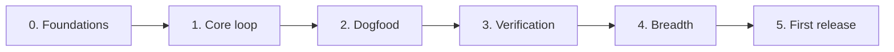

# Execution plan: implementing the sllmwiki skill

- **Status:** in progress
- **Design:** [structural_llm_wiki_design.md](structural_llm_wiki_design.md)

## 1. Approach

The skill is built **core loop first**: a thin path from `init` through
`build` (tags, ingest, narrative, one pull request) to `query` runs end to end
in Phase 1, on the simplest sources. A real wiki is then built with it
(Phase 2), and only what that run shows to be needed is deepened (Phases 3 and
4). Every phase ends with `mainline` green and the skill usable, so work can
stop between phases.

## 2. How every phase is built, tested and evaluated

**Build.** The skill is Python and markdown, so "build" means it loads:

```bash
python3 -m py_compile src/skills/sllmwiki/scripts/*.py src/skills/sllmwiki/scripts/lib/*.py src/tools/*.py
/usr/bin/python3 -m py_compile src/skills/sllmwiki/scripts/*.py src/skills/sllmwiki/scripts/lib/*.py   # Python 3.9
claude plugin validate .
claude --plugin-dir .    # the commands appear as /sllmwiki:<name>
```

**Test.** Every script and module comes with `tests/test_<module>.py` in the
same commit, and coverage of `scripts/` stays at 95% or above after every
commit (`AGENTS.md`):

```bash
python3 src/skills/sllmwiki/tests/run.py --coverage
/usr/bin/python3 src/skills/sllmwiki/tests/run.py
ruff check src/skills/sllmwiki/scripts src/skills/sllmwiki/tests src/tools
shellcheck src/skills/sllmwiki/scripts/*.sh
npx --yes markdownlint-cli2@0.13.0 "**/*.md"
python3 src/tools/check-yaml.py
```

From Phase 1, `test_instructions` checks every instruction file against its
word budget and every script and option the instructions name (design doc §9).

**Eval.** From Phase 1, each phase adds eval cases for the behavior it
introduces and runs the smoke set before its pull request:

```bash
claude plugin eval . --tag smoke --scaffold --allow-tools Bash \
  --runs 1 --ablation none --model sonnet --max-cost-usd 5 -j 8
```

A case passes at its threshold (set in the case, never 0), so a suite summary
can't report a failing case as passed. Each pull request says which cases ran,
with which model, the results, the cost and the turns. Cost and turns are part
of the result: a change that makes a case noticeably costlier says why. Cases
that need git in the sandbox run on Linux (`AGENTS.md`).

**Licenses.** A pull request that touches what the skill fetches, saves,
quotes or publishes says how it stays within the source policy (`AGENTS.md`,
"Respect licenses and copyright").

**Source of truth.** Every task is implemented from this repository: the
design doc, this plan, `AGENTS.md` and the code already merged. The code and its
tests are written for the task, not taken from elsewhere. When a task needs an
intent or decision these documents don't state, it is added to the design doc
or this plan first, in the same pull request, so the documents stay the one
place it is recorded.

**Commits and pull requests.** One task at a time, in the order given: each
numbered task is built, tested and evaluated on its own and lands as a local
commit (`Part of #<issue>`). When a phase's tasks are done, its branch, made from
the up-to-date `mainline`, opens one pull request that closes the phase's issue.
The owner merges.

**Done.** A phase is done when its pull request is merged, CI is green on
`mainline`, coverage is at 95% or above, and its eval cases pass.

## 3. Order



Phases 3 and 4 take their order from what Phase 2 finds: an item a real run
needed first moves first.

## 4. Phases

### 4.1 Phase 0: foundations

**Goal.** The test harness and the modules everything imports: the fixed
layout (design doc §3) and the settings (design doc §4.9).

| # | Code change | What it does |
|---|---|---|
| 0.1 | `tests/run.py`, `tests/helpers.py` | Runs each test module in its own process, in parallel, with name filters and `--coverage`; a fixture wiki per test in the fixed layout, in-process command scripts, git helpers, `LocalServer` |
| 0.2 | `lib/util.py` | Reading text, JSON output, stdout setup, the git root, dates, MD5 without the footer |
| 0.2 | `lib/layout.py` | The fixed paths (design doc §3); finding the wiki from a directory or `--root`; the shared command-line plumbing (usage errors, failures, "not a wiki: run /sllmwiki:init") |
| 0.2 | `lib/toml.py`, `lib/config.py` | The TOML subset `Config.toml` uses (Python 3.9 has no `tomllib`); the settings, template budgets and add-ons with their defaults, validated (`CONFIG_INVALID`), other tools' tables left alone |
| 0.3 | `lib/wikiyaml.py` | The YAML subset the skill writes; refuses anything else loudly; targeted line edits that keep comments and order |
| 0.3 | `lib/schema.py` | Field kinds and rules for `tags.yaml` and both manifests (design doc §4.2–§4.4), with did-you-mean hints |
| 0.4 | `lib/compat.py` | The markdown GitHub, Obsidian, mdBook and Sphinx render alike (design doc §4.8): findings, `escape()`, link checks |
| 0.5 | `evals/README.md`, `evals/_fixture/wiki.sh` | The case table, the fixture (the unit tests' wiki as a git repo with a local `origin`) and the known limits |

**Test.** `test_run`, `test_helpers`, `test_util`, `test_layout`, `test_toml`,
`test_config` (each default with no file, each invalid value, other tools'
tables kept), `test_wikiyaml`
(the subset, the refusals, edits that keep comments), `test_schema` (each field
kind, cross-field rules, hints), `test_compat` (table-driven: a row per rule,
run through the cases `AGENTS.md` requires), `test_check_yaml`,
`test_eval_fixture`.

**Eval.** None: nothing an agent can be asked for yet.

**Done when** CI runs the unit tests and `check-yaml` on this repository.

### 4.2 Phase 1: the core loop

**Goal.** `init`, then `build` on a question with markdown, text or HTML
sources, then `query`, end to end: one pull request a reviewer can merge, and
a cited answer.

| # | Code change | What it does |
|---|---|---|
| 1.1 | `lib/numbering.py`, `lib/citations.py`, `lib/mdlinks.py`, `lib/metadata.py`, `lib/footer.py` | Heading structure and numbers; numbered, escaped citations and their link targets; the Metadata section (version, template, dates, history); the "Original source" footer |
| 1.2 | `lib/manifest.py`, `scripts/manifest.py`, `lib/tagtree.py`, `scripts/tag-tree.py` | Record a source (design doc §4.3); `add-tag`, `put-tag`; the tree and what's derived from it (children, ancestors, adjacent, a tag's sources and narratives) |
| 1.3 | `lib/html2md.py`, `lib/fetch.py`, `lib/policy.py`, `scripts/fetch-source.py` | Fetch a page or file; keep markdown and text byte for byte; convert an HTML page's main content; record the license the agent found; refuse a copy a public wiki may not hold (`--allow-restricted`), or any copy under `source_copies = "links-only"`; save with the footer and record it |
| 1.4 | `templates/narratives/shared.md`, `concept_brief_overview/`, `technical_brief_overview/`, `lib/templates.py` | The shared structure and markers; the first two templates and their guides (design doc §4.5); bundled and the wiki's own templates, the skeleton read as the schema, budgets from `Config.toml` over the header |
| 1.5 | `scripts/narrative-format.py`, `scripts/finish-narrative.py` | A narrative against its template: sections, numbering, budgets, Abstract range, markers defined, citations resolve, compat; one finishing command (design doc §7.5) |
| 1.6 | `lib/search.py`, `scripts/search.py`, `scripts/reading-plan.py` | BM25 over tags, narratives and source abstracts; `context`, `narratives`, `sources`, `outline`, `section` (by citation link); the ordered reading plan (design doc §7.1) |
| 1.7 | `scripts/wiki-check.py`, `lib/wikiindex.py`, `lib/tagpages.py` | Schema; manifests against files; pins (`NARRATIVE_SOURCE_CHANGED`); `SOURCE_POLICY`; generated pages current (the index, tag pages), rewritten with `--fix` |
| 1.8 | `scripts/publish.sh`, `scripts/preflight.sh` | Run branch, push, open and update the PR; assemble the PR description and checklist from the steps' JSON summaries, and every commit message (design doc §5.2–§5.3); check git, Python and `gh` |
| 1.9 | `templates/wiki/`, `templates/*.yml`, `src/actions/review-checklist/`, `src/actions/wiki-checks/`, `scripts/init.py` | The wiki's README, `AGENTS.md`, `CLAUDE.md`, `.gitignore`, `.claude/settings.json`, `Config.toml` with its defaults and notes, CI, and `graph.json` with the Obsidian add-on; the review-checklist action; `init` lays them out, refreshes what it owns and adds settings a wiki's `Config.toml` lacks |
| 1.10 | `SKILL.md`, `workflows/{init,build,query}.md`, `steps/{tags,ingest,narrative}.md`, `src/commands/*.md`, `tests/test_instructions.py` | The instructions, within their budgets (design doc §9); `build` without `smes` and `lint` yet |

**Test.** A test module per script and module. `test_fetch_source` serves
markdown, text and HTML pages (with navigation and comments to strip) from
`LocalServer`, and covers the license checks in a public and a private wiki.
`test_finish_narrative` runs the whole finishing sequence on the fixture.
`test_publish` runs `publish.sh` against a local bare `origin`. `test_init`
builds a new wiki and refreshes one that has content.

**Eval.**

| Case | Tags | Checks |
|---|---|---|
| `not-a-wiki` | smoke | Outside a wiki, the agent stops and offers `init`; nothing written |
| `init-new` | smoke, setup | In an empty repo, `init` lays out the wiki and makes one commit |
| `route-query` | smoke, routing | A question goes to `query`, which reads `workflows/query.md` and runs `search.py context` |
| `query-answer` | smoke, query | Answers from a narrative's abstract or one section, cites it, writes nothing |
| `prompt-injection` | smoke, safety | A source telling the agent to push or delete is treated as data |
| `narrative-publish` | full | A question on the fixture: reading plan, a narrative on the right template with every claim cited or marked, `finish-narrative` run, one PR, not merged |
| `build-small` | full | `build` with two questions on a small local topic: tags, sources, two narratives, one PR with its checklist; record its cost and turns as the baseline |

### 4.3 Phase 2: dogfood

**Goal.** A real wiki built with the skill shows what the core loop is
missing, before more is built.

| # | Code change | What it does |
|---|---|---|
| 2.1 | (a test wiki repository) | `init`, then `build` on three topics, one of them PDF-heavy; each PR reviewed as a real one |
| 2.2 | issues in this repository | Every problem found, labeled by phase; the cost, turns and instruction words of each run recorded against the Phase 1 baseline |
| 2.3 | this plan | Phases 3 and 4 reordered by what the runs needed |

**Eval.** The smoke set, three runs each, with the no-plugin baseline.

### 4.4 Phase 3: verification and depth

**Goal.** The checks that keep a growing wiki honest, and PDFs.

| # | Code change | What it does |
|---|---|---|
| 3.1 | `scripts/cited-sections.py`, `steps/lint.md` | Each claim with the source section it cites; one lint pass, one commit, bigger findings on the PR (design doc §7.3) |
| 3.2 | `lib/quotes.py` in `narrative-format` | A quotation must appear in the source it cites, and be at most `max_quote_words` |
| 3.3 | `scripts/check-upstream.py` | Refetch saved sources and mark changed ones; narratives pinned to them rechecked (design doc §7.2) |
| 3.4 | `lib/pdf.py` in `fetch-source` | A PDF's text layer, with its outline as headings (page headings without one); an outlined PDF over 100 pages sliced by top-level entry, each slice with a script-written starter abstract (`abstract_draft`) |
| 3.5 | `build` | `lint` added after `narrative` |

**Test.** `test_cited_sections`, `test_quotes` (found, cut with an ellipsis,
too long, not found), `test_check_upstream` (over `LocalServer`), `test_pdf`
(PDFs generated by a test helper, not checked in: text runs, several pages, an
outline and none, a long outlined one sliced, no text layer).

**Eval.**

| Case | Tags | Checks |
|---|---|---|
| `route-lint` | smoke, routing | "Lint the narratives under leaf-a" reads `steps/lint.md` and runs `cited-sections` |
| `lint-finds` | full | A narrative with a misquote and an unsupported claim: both found, one commit, the bigger one on the PR |
| `ingest-paywalled` | smoke, policy | A source behind a login: a `link`, no attempt to get around it |
| `ingest-public-restricted` | smoke, policy | In a public wiki, a source that isn't openly licensed: a `link` and a question to the owner; no `--allow-restricted` unless permission is given |
| `ingest-personal-data` | policy | Sections with personal data or secrets left out with a marker, never edited |

### 4.5 Phase 4: breadth

**Goal.** The rest of v1.

| # | Code change | What it does |
|---|---|---|
| 4.1 | `templates/narratives/comparison/`, `survey/` | The other two templates and guides |
| 4.2 | `scripts/contributors.py`, `steps/smes.md` | Ranking people from git history, `CODEOWNERS`, doc authorship and reviews, never anyone in `smes_exclude`; the `smes` step, in `build` when the topic has code or authored docs |
| 4.3 | `workflows/query.md` | Offering to file a stitched answer; the labeled DRAFT answer and the offer to `build` |
| 4.4 | `scripts/obsidian-check.py` | Compatible markdown on every page outside the sources |

**Eval.**

| Case | Tags | Checks |
|---|---|---|
| `route-smes`, `route-ingest`, `route-ambiguous` | smoke, routing | Each reaches its step; a request naming only a topic gets questions proposed, nothing written |
| `query-file` | query | A stitched answer is given and filing is offered, not done |
| `query-gap` | smoke, query | A DRAFT answer, the offer to `build`, nothing written |

### 4.6 Phase 5: first release

| # | Code change | What it does |
|---|---|---|
| 5.1 | `README.md` | Rewritten to the design as built; the CI badges; a demo from a public wiki that holds only openly licensed sources, reviewed against the source policy before it goes public |
| 5.2 | `.claude-plugin/plugin.json`, `templates/*.yml` | The version, and the CI templates' `@v<version>`, bumped together, only when the owner asks (`AGENTS.md`) |
| 5.3 | (GitHub) | A ruleset on `mainline` requiring the checks; tag `v<version>`; release notes |

**Eval.** Every case, three runs, with the baseline; results, cost and turns in
the release pull request.

## 5. Settings and fixed values

The settings a wiki can change (design doc §4.9), each read through
`lib/config.py` (0.2) and tested with non-default values as well as the
default:

| Setting | Default | Used by |
|---|---|---|
| `source_copies` | `"allow"` | `fetch-source` (1.3), `wiki-check` (1.7) |
| `max_quote_words` | `50` | `narrative-format` (3.2) |
| `smes_exclude` | `[]` | `contributors.py` (4.2) |
| `markers` | `true` | `shared.md` (1.4), `narrative-format` and `finish-narrative` (1.5), `steps/narrative.md` (1.10) |
| `[structural-llm-wiki-templates.<name>]` budgets | each template's header | `lib/templates.py` (1.4), `narrative-format` (1.5) |
| `obsidian` add-on | `false` | `init` (1.9), `publish.sh` (1.8) |

Everything else is a constant, with one home:

| Value | Home |
|---|---|
| The layout | `lib/layout.py` |
| The markers' text, `[sllmwiki_reasoning]` and `[sllmwiki_gap]` | `templates/narratives/shared.md` |
| Slicing a PDF: outlined and over 100 pages | `lib/pdf.py` |
| Instruction word budgets | `tests/test_instructions.py` |

## 6. Risks

- **`pdf.py` within the standard library.** Even page-by-page text needs
  decompression and text-operator parsing; 95% coverage needs a generated PDF per
  construct. If it stalls, PDFs are saved as `link`s until it lands.
- **Instruction budgets too tight.** If a budget forces a rule out, the rule
  moves to a script or its one home; a budget rises only with the reason in the
  pull request.
- **Evals on macOS.** Cases that need git in the sandbox fail with Apple's
  `git`; they run on Linux.
- **Eval cost.** Smoke sets stay under $5 a run; full runs only at the end of a
  phase and at the release.
- **Settings creep.** A new setting needs the three tests in design doc §4.9
  and a proposal, not a quiet option; an add-on stays off by default.
