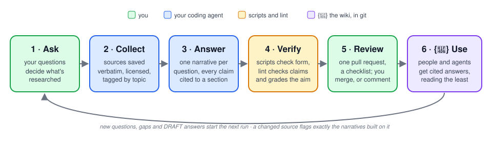
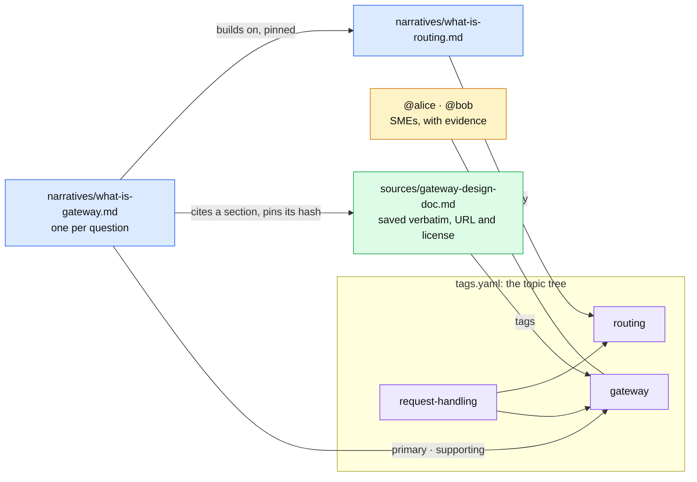
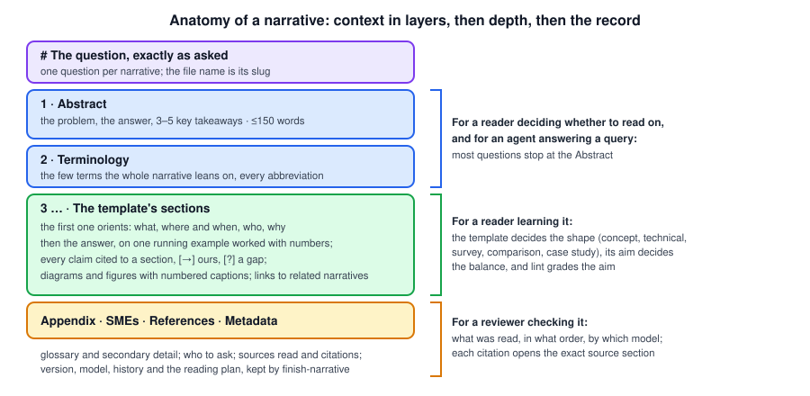
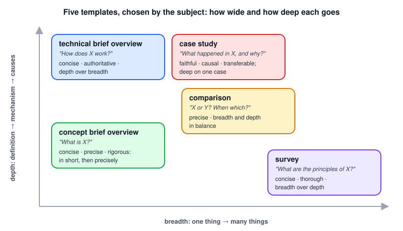
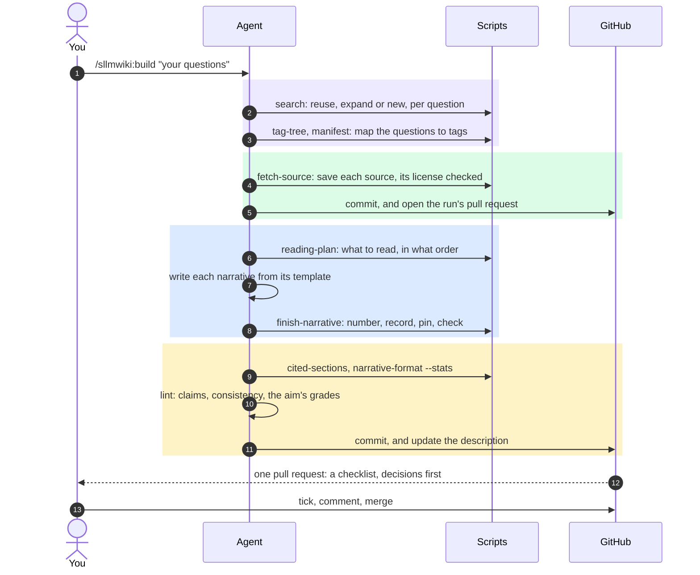
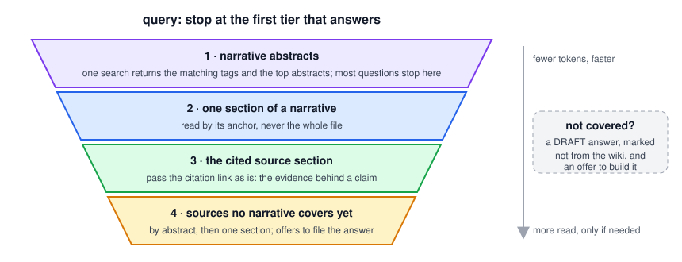
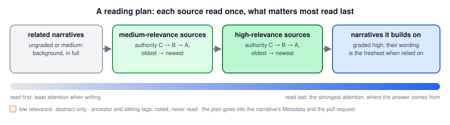
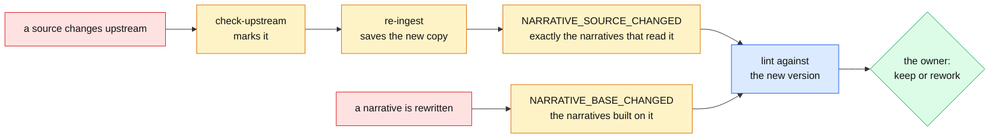

# {📖} Structural LLM Wiki — Design

## 1. Overview

### The problem

Most of what a group knows about its systems isn't written down in one place. Design docs drift from the code, decisions get buried in chat threads and code reviews, and the rest lives in the heads of a few people. New engineers rebuild the same understanding from scratch, and experienced ones answer the same questions again and again.

AI assistants help, but only for the moment: an answer from a chat session is gone when the session ends, nobody can easily check where it came from, and nothing tells you when it stops being true. The group's understanding doesn't accumulate.

### The approach

The Structural LLM Wiki gives that knowledge a durable home: a git repository the coding agent maintains and the group reviews. The work happens in six moves:

1. **Ask.** A run starts from the questions someone wants answered. The questions decide which topics, sources and people matter.
2. **Collect.** The agent finds the sources those questions need and saves them in the wiki, verbatim, so every claim can be checked later. Each source is attached to hierarchical topic tags, which connect sources, narratives and the people who know each area.
3. **Answer.** For each question, the agent reads what the question needs, once, and writes a narrative that answers it, with every claim traced to a section of a source.
4. **Verify.** Scripts check everything mechanical; lint checks each claim against the source section it cites and against related narratives, and grades each narrative against its template's aim. When a source changes, exactly the narratives that depend on it are checked again.
5. **Review.** The run lands as one pull request with a review checklist; the owner comments or merges.
6. **Use.** A person or another agent asks the wiki a question and gets a cited answer, read from the smallest thing that answers it: a narrative's abstract, one section, one cited source section.



*Figure 1-1: The knowledge loop. Green is you, blue your coding agent, amber the scripts and lint, purple the wiki in git.*

Each run arrives as a single pull request against the default branch, so people stay in control of what enters the wiki without having to do the research. Over time the wiki builds up instead of decaying: answers stay linked to their evidence, new findings are reconciled with old ones, and the history shows how the group's understanding evolved.

This document covers the architecture and the decisions behind it. The skill's files are the source of truth for step-by-step behavior: `src/skills/sllmwiki/workflows/` and `src/skills/sllmwiki/steps/`.

**One skill: two workflows made of steps.** `build` builds knowledge (§5) and `query` uses it (§6), plus a one-time `init`. They are made of five steps: `tags`, `ingest`, `smes`, `narrative` and `lint`, and each step also runs on its own. They share one data model, one set of scripts and one set of rules, so they live in a single skill: `SKILL.md` routes to a workflow or step file, which the agent reads only when it runs. Separate skills would each need their own copy of the scripts, since an installer copies one skill folder at a time and a skill can rely only on files inside it.

## 2. Principles

- **The wiki is a dedicated git repository.** Git provides history, review and rollback.
- **Sources are ground truth.** Sources are saved verbatim (§4.3) and never summarized or edited. Narratives are built from them and checked against them.
- **Every claim is traceable.** A claim in a narrative cites a section of a saved source with a numbered link (`claim [\[3\]](../sources/<file>.md#<section>).`, inside the sentence as in a paper, several separated by commas, brackets escaped so Obsidian doesn't read `[[3]]` as a wikilink), or is marked as the narrative's own reasoning (`[→]`) or as a gap the sources don't answer (`[?]`). §4.10 defines the markers, and how a wiki turns them off.
- **The question drives the run.** Tags, sources and the reading plan are chosen for the questions asked, not for a topic in general, so nothing is collected that no answer uses.
- **Runs are unattended; review happens on one pull request.** A run takes its questions at the start and doesn't pause; what it can't decide goes to the top of its pull request. The owner reviews, ticks the review checklist and merges.
- **Build on what exists.** One narrative per question. Before writing, look for a narrative that already covers it, and reuse or expand it (§7.4).
- **Store facts, derive the rest.** Manifests hold only what no file can tell: where a source came from, when, its license, its tags and abstract, which source versions a narrative was built from, and which narratives it builds on. Sizes, hashes, titles, versions and dates are read from the files when needed, and generated pages (the index, tag pages) are rewritten by every script that writes a manifest, and by `wiki-check.py --fix`. Nothing derived is stored, so nothing derived can drift.
- **Spend tokens on judgment, and keep attention on what matters.** The agent never does the same work twice and never reads more than the task needs:
  - **Repetitive work is a script's.** Counting, hashing, numbering, formatting, assembling commit messages and PR descriptions, and checking structure run as scripts, which cost no tokens and give the same answer every time.
  - **Read the smallest thing that answers.** Abstracts before sections, a section before a whole file, search results instead of browsing. Scripts print compact findings, not file contents.
  - **Read each source once per run.** Ingest reads a source to write its abstract; the narrative step reads what its plan says, once; lint reads only the sections the narrative cites (§7.3).
  - **Do nothing twice.** What a run works out once (the tag classification, the reading plan) is carried forward; an unchanged source isn't re-read; only the narratives pinned to a changed source are rechecked (§7.2).
  - **Load instructions only when they run, within a budget.** `SKILL.md` routes; a workflow or step file is read only when it runs; every instruction file has a word budget a test enforces (§9).
  - **Keep the right attention.** The context holds what the question needs, the most relevant, authoritative and newest material last (§7.1); parent and neighboring topics are noted, not read.
- **Say each rule once.** Every rule has one home (§9), and other files point to it.
- **Readable where people read.** Plain markdown that renders the same on GitHub, in Obsidian and in the book renderers (§4.8), with no export step and no second copy.
- **Only what's used.** A setting exists only when a real wiki or a group's policy needs it, it has a safe default, and a script enforces it (§4.9). An add-on is off until a wiki turns it on, and it costs nothing while off. No migrations, and no states a real wiki hasn't needed (§11 lists what waits).
- **Tool-neutral.** The workflows name capabilities (docs search, code search, page fetch, git history) rather than specific tools.

## 3. Layout

**This package** (the `sllmwiki` plugin, in the `structural-llm-wiki` repository):

```text
structural-llm-wiki/
├── .claude-plugin/
│   ├── plugin.json                        # Claude Code plugin manifest
│   └── marketplace.json                   # makes this repo a plugin marketplace
├── src/
│   ├── skills/sllmwiki/                   # the one skill
│   │   ├── SKILL.md                       # routing and the rules every run shares
│   │   ├── workflows/                     # build, query, init: read when the workflow runs
│   │   ├── steps/                         # tags, ingest, smes, narrative, lint: read when the step runs
│   │   ├── scripts/                       # the deterministic scripts, each documented by its --help
│   │   │   └── lib/                       # shared modules
│   │   ├── templates/                     # narratives/ (templates and guides); languages/ (language packs); wiki/ (what init installs)
│   │   └── tests/                         # unit tests for the scripts, and the instruction budgets
│   ├── commands/                          # Claude Code commands, one per workflow and step
│   ├── actions/                           # GitHub actions a wiki's CI calls
│   └── tools/                             # CI-only tools outside the skill (check-yaml)
├── evals/                                 # behavior evals, outside the skill so they never ship with it
└── docs/
    ├── images/                            # this document's and the README's figures
    ├── structural_llm_wiki_design.md      # this file
    └── skill_execution_plan.md            # how it is built
```

**A wiki repository** (created by `init`), always laid out the same way:

```text
<wiki-repo>/
├── README.md                 # what this wiki is, how to use it, and its marker convention (§4.10)
├── SLLMWIKI_INDICES.md       # generated: a clickable map of the tag tree, for GitHub
├── AGENTS.md                 # rules for agents working in this repo
├── CLAUDE.md                 # imports AGENTS.md for Claude Code
├── .gitignore
├── .claude/settings.json     # offers the sllmwiki plugin to the group's members
├── .github/workflows/        # wiki-checks.yml; review-checklist.yml (red until a run PR's boxes are ticked)
├── Config.toml               # optional: the wiki's settings and add-ons (§4.9)
├── templates/                # optional: the wiki's own narrative templates (§4.5) and languages/ packs (§4.9)
└── sllmwiki/                 # the knowledge: also the Obsidian vault and a book's source
    ├── .obsidian/graph.json  # with the Obsidian add-on: written once by init
    ├── tags/
    │   ├── tags.yaml         # the tag tree
    │   └── <tag>.md          # generated: a page per tag
    ├── sources/              # sources, saved verbatim
    │   └── manifest.yaml
    └── narratives/           # narratives, one per question
        ├── figures/<slug>/   # figures a narrative generates (§4.5)
        └── manifest.yaml
```

The layout is fixed: the scripts know it, and no setting changes it. A repository is a wiki when `sllmwiki/tags/tags.yaml` exists; every workflow but `init` stops and points to `init` otherwise.

## 4. Data model



*Figure 4-1: The data model. Tags (purple) connect sources (green), narratives (blue) and the people who know each area (amber); a narrative cites sections of its sources and pins the versions it read, and pins the narratives it builds on.*

### 4.1 Topic tags

A **topic tag** connects sources, narratives and people.

- One source or narrative has one or more tags; a tag has many sources, narratives and SMEs.
- Tags form a tree. Sources and narratives attach to the **most specific tag they are about**; a parent holds what covers it as a whole. Giving a tag a child moves nothing.

For a question, the tags it touches are **primary** (its core topic, read last) or **supporting** (related context, read first), recorded in the narrative's manifest entry. A tag's **ancestors** and **adjacent** tags (its siblings) are derived from the tree when needed: noted, never read, and never stored.

### 4.2 `tags.yaml`

```yaml
request-handling:
  description: "Components that receive, route and serve requests"
  parent: null

gateway:
  description: "The gateway service: routes incoming API requests to the right backend"
  parent: request-handling
  smes:
    - "@alice: wrote the design doc; 45% of router.go"
    - "@bob: 30 commits in the last 3 months"
```

A tag stores only its description, its parent and its SMEs. Its children, sources and narratives are derived: children from `parent`, sources and narratives from the manifests' `tags` fields. `tag-tree` answers questions about the tree, and `manifest.py add-tag` / `put-tag` write it, so the YAML is never edited by hand.

**Schema.** `tags.yaml` and both manifests have a schema (`lib/schema.py`): each field's kind, whether it is required, and rules across fields. `wiki-check` reports missing, unknown (with a did-you-mean hint), mistyped and invalid fields as errors, so the wiki's CI fails the pull request.

### 4.3 Sources and `sources/manifest.yaml`

A source is saved as the most faithful text that can be checked:

| Kind | Saved as |
|---|---|
| `text` | markdown or plain text, byte for byte; a plain-text standard (an RFC, three or more numbered sections) with its numbered sections as headings, each section verbatim in a fenced block, its page headers and footers left out |
| `html` | the page's main content (`<main>` or `<article>`, without navigation, comments or scripts) converted to markdown by a small converter: headings, paragraphs, lists, tables, code, links. Images stay links to the original |
| `pdf` | the text layer, with the PDF's own outline (its bookmarks) as the headings, so sections and citations follow its chapters and sections; `## Page <n>` headings only for a PDF without an outline |
| `tex` | a LaTeX source's body: its sections as headings, its math kept as TeX (`$…$`, `$$…$$`), its formatting as markdown, the rest of its markup dropped; `\input` files read from beside it |
| `code` | a code file verbatim in one fenced block, so a citation names its lines as the file numbers them: `#L10-L20` |
| `link` | nothing: a pointer (live code, dashboards, a source that may not be copied) |

Each saved file ends with a generated "Original source" footer (its URL and license), which is left out of its hash. One entry per source, keyed by slug (`<topic>-<source-name>`):

```yaml
gateway-design-doc:
  file: sources/gateway-design-doc.md      # absent for a link
  kind: html
  url: https://docs.example.com/gateway/design
  published: "2026-07-13"                  # the source's own date, when it has one
  ingested: "2026-07-14"
  license: "CC-BY-4.0"                     # SPDX id, or "unknown" or "proprietary"
  license_url: https://docs.example.com/license
  # permission: "Jane Doe, 2026-07-14: may keep a copy"   # only with --allow-restricted
  tags: [gateway, routing]
  abstract: "Original gateway architecture and design rationale. …"   # 150–250 words
```

The file's size and hash are read from the file. A source is **stale** when `check-upstream` fetches it again and the content differs from the saved copy; it is marked with `upstream_changed: "<date>"` until it is re-ingested. A large source is saved like any other and listed with its size in the run's pull request; reading by section (§6.1) keeps its size from mattering.

**Large outlined documents are sliced by chapter.** Reading by section makes a file's size harmless, but choosing what to read happens by abstract, and one abstract is too coarse for a book. So a PDF over 100 pages that has an outline is saved as one source per top-level outline entry (`<slug>-<n>-<chapter>`), each tagged on its own. Shorter documents, and documents without an outline, stay one file. A slice starts with a script-written abstract (its title and opening paragraph, `abstract_draft: true`), which costs no tokens; the agent replaces it with a real one only when a question first reads the slice.

### 4.4 Narratives and `narratives/manifest.yaml`

```yaml
what-is-gateway:
  template: technical_brief_overview
  tags:
    primary: [gateway]
    supporting: [routing]
  read:                                    # the source versions the narrative was built from
    gateway-design-doc: 9f8e7d6c5b4a…      # MD5 of the saved file, without its footer
  grades:                                  # the reading plan's grades (§7.1)
    gateway-design-doc: {relevance: high, authority: A}
  models:                                  # the model that wrote each version
    '1.0': claude-opus-5-5
  built_on:                                # the narratives it builds on, by a hash without their Metadata
    what-is-routing: 3c2b1a0f9e8d…
```

The question (the title), the Abstract, the version and the dates live in the narrative and are read from it. The grades and models are the record behind the narrative's Model and Reading plan, which `finish-narrative` writes into its Metadata, so a reader sees what was read, in what order and why, and which model wrote it. When a source is re-ingested and its hash no longer matches a pin, `wiki-check` reports `NARRATIVE_SOURCE_CHANGED` for exactly the narratives that read it. The narratives a narrative builds on, those its reading plan graded high, are pinned the same way (`built_on`, by a hash of each one's content without its Metadata), so when one is rewritten, `wiki-check` reports `NARRATIVE_BASE_CHANGED` for the narratives that rely on it.

### 4.5 Narratives

One question per file in `narratives/`; the question is the title, unchanged.

**Structure.** Every narrative has the same top and appendices, defined once in `templates/narratives/shared.md`: an **Abstract** (one sentence on the problem, the answer in two or three, then 3–5 key takeaways; 80–150 words), a small **Terminology** table of the terms the whole narrative leans on and every abbreviation, the body, then an optional **Appendix** (the Glossary, and details and examples a reader may want but doesn't need to follow the answer), **SMEs**, **References** (sources read, code references, related narratives, citations) and **Metadata** (version, template, model, history, reading plan). Every heading of level 2 to 4 is numbered (`## 1. Abstract`, `### 5.1 …`). The shared writing guide holds the style every narrative shares, each rule stated once, in priority order: context once, in layers (the Abstract for a reader deciding whether to read on, the first section's orientation, each key example's scene, each section's opening), ideas before sources, the map before the details, one or two key examples carried through the sections, a shape that fits the content, and detail in its place. A template's guide adds only what its kind of narrative needs.



*Figure 4-2: Anatomy of a narrative. Blue is for a reader deciding whether to read on, and for `query`; green for a reader learning the subject; amber for a reviewer checking it.*

**Orientation.** Every narrative's first section orients the reader in a few sentences before any definition or mechanism: what the subject is, where and when one meets it, who deals with it, and why it matters.

**Links between narratives.** A narrative that mentions a concept another narrative covers links to it, to its section where one fits, and says it in a sentence at most instead of explaining it again, so the wiki says each thing once and its narratives connect. Section anchors carry the section's number, so `narrative-format` and `wiki-check` report a link to a section that isn't there (`NARRATIVE_ANCHOR`), and `finish-narrative` and `wiki-check --fix` repair one whose section was only renumbered.

**Figures.** Diagrams are mermaid by default. Where mermaid can't show an idea well, such as a curve, measured data or geometry, a narrative may embed a figure it generates, computed from its own formulas or cited numbers, never copied from a source. It is an SVG (a PNG only for what SVG can't hold), the two formats GitHub, Obsidian, mdBook and Sphinx all show, in `narratives/figures/<slug>/`, and it is kept small for the agents that may read it: an SVG under 40 KB, a PNG under 150 KB and 1600 px wide. Every diagram and figure has a caption line under it, `*Figure 5-1: what it shows.*`, numbered by its section; with the alt text, the caption says what the picture shows, so no agent needs to open it. `finish-narrative` renumbers the captions and the references to them. `narrative-format` checks a figure's place, format, alt text and size, that an SVG is self-contained and has an opaque background for dark themes, and every caption; `wiki-check` reports a figure no narrative shows. `images = false` (§4.9) keeps a wiki to mermaid.

**Templates.** A template is a folder with `template.md` and `guide.md`. The skeleton is the schema: its headings are the required sections, in order; a heading ending in `(optional)` may be left out; a section holding a ` ```mermaid ` placeholder needs a diagram. A short YAML header gives `description`, `use_when`, `max_words` (the body's budget) and `abstract_words`. The guide (audience and purpose with its aim, voice and tone, structure, evidence, length, checklist, and for the bundled templates, examples) holds the style, and every template's guide is written for a reader new to the topic: the problem before the mechanism, prerequisites before use, one notation throughout, rules of thumb for every parameter. Its Examples section says where the narrative's one or two key examples appear in each of its sections, so the reader never switches context to follow a point.

A template is chosen by the subject, not the question's wording:

| Template | Subject | Focus | Takeaway: a reader new to the subject … | Budget |
|---|---|---|---|---|
| `concept_brief_overview` | A concrete subject that has a concise, precise definition | A short overview (what, where and when, who, why); the definition in short, to set the intuition, then precisely, from the source that defines it most exactly, with the nuances that adds; its consequences; and its edge cases | has learned the concept | 1,200 words |
| `technical_brief_overview` | A solution, an algorithm, or the design of a component or for a problem | How it works: the core idea and its picture first, then a walkthrough on one running example, then variants and trade-offs | has learned the solution or design | 1,800 words |
| `comparison` | A choice among common candidates | Each candidate in turn on one base scenario, a condition changed until it wins; then when to pick which, and every dimension to think through | knows each candidate, what sets it apart, and which one their situation calls for | 1,500 words |
| `survey` | Anything not concrete: a domain, or an umbrella term for subtopics or directions that each go deep their own way | Wide over deep: the main dishes on the table that one can't miss, an overview with context and scope, the items grouped and mapped first, their tensions, classic case studies, where to go deeper | knows the main areas of the domain and where to go deeper in each | 2,200 words |
| `case_study` | One real, documented instance a concept or domain is known by: an incident, a production system, a design decision | Deep on the one case, in one of two shapes (an incident's timeline, a decision's options): its context, what happened, why (the causal chain), the ideas at work (linked to their narratives), the lessons that carry over | knows what happened and why, and can apply its lessons elsewhere | 1,500 words |

Four are shown in the [demo wiki](https://github.com/mengjiasun1992/sllmwiki-demo): [concept](https://github.com/mengjiasun1992/sllmwiki-demo/blob/main/sllmwiki/narratives/what-is-a-distributed-system.md), [technical](https://github.com/mengjiasun1992/sllmwiki-demo/blob/main/sllmwiki/narratives/what-is-an-ewma-exponentially-weighted-moving-average-and-how-does-it-work.md), [comparison](https://github.com/mengjiasun1992/sllmwiki-demo/blob/main/sllmwiki/narratives/when-should-software-use-an-ewma-instead-of-other-moving-averages.md) and [survey](https://github.com/mengjiasun1992/sllmwiki-demo/blob/main/sllmwiki/narratives/what-are-the-common-design-tenets-and-principles-for-distributed-systems.md).

**Aims.** Each template names its aim, the few qualities its narratives are graded on, and its guide says what each means in practice:



*Figure 4-3: The five templates by how wide and how deep each goes, with their aims.*

| Template | Aim |
|---|---|
| `concept_brief_overview` | concise, precise, rigorous |
| `technical_brief_overview` | concise, authoritative, depth over breadth: the core idea and how it works carry at least half the body |
| `survey` | concise, thorough, breadth over depth: every item the sources agree on, or named as left out |
| `comparison` | precise, breadth and depth in balance: every common candidate, depth only where it decides the choice |
| `case_study` | faithful, causal, transferable; deep on one case: every event cited, the chain from trigger to impact explained, each lesson with when it holds |

Lint grades each narrative on each axis of its template's aim, met, partly or missed, with the evidence, helped by `narrative-format.py --stats` (the body against its budget; words, citations and markers per section; citations by the authority of what they cite).

**A wiki's own templates.** A group can bring its own: a folder in the wiki's `templates/` with a `template.md` and a `guide.md` is offered next to the bundled ones, and is checked the same way (`lib/templates.py`): the header's four keys; the guide's six sections, with the **Takeaway** and the **Aim** whose axes lint grades every narrative on; and a body of `##` sections, each with its `<…>` line, repeating none of the shared ones. One with a bundled template's name replaces it. `/sllmwiki:template` makes one with the agent, from the closest template. A wiki that only wants a different budget for a template sets it in `Config.toml` (§4.9) instead of copying the template.

**What scripts do for every narrative.** After any edit, the agent runs one command, `finish-narrative` (§7.5): it numbers the headings and figure captions, repairs links to a renumbered section of another narrative, escapes what the renderers would misread (§4.8), converts old markers and adds a Terminology row for each marker the narrative uses (when markers are on), bumps the version and history when asked, writes the manifest entry with the current pins of the sources it read and the narratives it builds on, and regenerates the index and tag pages. The agent writes the content; the script does the rest.

### 4.6 Why YAML

YAML is human- and model-readable, `grep`- and `yq`-friendly, and diffs cleanly in review; a database would hide changes from review and from the model. The skill reads it with a narrow subset reader (`lib/wikiyaml.py`) that covers exactly what its writers produce and fails loudly on anything else, and writes it with targeted line edits that keep comments and order. The expected scale is tens to low hundreds of sources per wiki.

### 4.7 Source policy

The wiki keeps verbatim copies, so the skill follows a source policy ("Source policy" in `SKILL.md` is its one home):

- **Copyright** stays with each source's authors; a copy transfers no rights, and narratives are original writing with brief, attributed quotations (at most `max_quote_words`, 50 by default, checked by `narrative-format`).
- **Attribution:** every saved source keeps its URL and license in its footer and manifest entry.
- **Access controls are never bypassed:** no logins, paywalls, registration walls or anti-bot protection, and no unofficial copies. A rate limit (HTTP 429) is a request to wait, not a refusal: the fetch is retried up to three times with exponential backoff and jitter, honoring a `Retry-After` of up to a minute, and then the source is recorded as a link.
- **What may be copied depends on who can see the wiki.** A private repository keeps reference copies unless a source's terms forbid sharing; a public one keeps only openly licensed sources. Anything else is a `link`. A group whose policy allows no copies at all sets `source_copies = "links-only"` (§4.9), and every source is a `link`.
- **No personal data or secrets,** whatever the license; sections holding them are left out with a marker, never edited.

The judgment is the agent's: it reads the source's license or terms and records them (`--license`, `--license-url`). The scripts enforce what can be checked: `fetch-source` asks GitHub whether the repository is public and refuses to save a copy whose recorded license isn't open there (`--allow-restricted "<who, when>"` records the owner's permission instead, as the source's `permission`), or any copy at all under `links-only`, and `wiki-check` fails the wiki's CI (`SOURCE_POLICY`) on any saved copy a public wiki may not hold, or any saved source without its URL and license.

### 4.8 Markdown everyone renders alike, and Obsidian

A wiki is read on GitHub page by page, opened in [Obsidian](https://obsidian.md) as a graph, and can later be built as a book with mdBook or Sphinx and MyST-Parser. Its markdown keeps to what all four render alike, as `lib/compat.py` defines it: markdown links relative to the linking file, spaces as `%20`, links to files not folders; no wikilinks, embeds, highlights, `%%` comments, block IDs or inline `#tags`; only GitHub's five alerts as callouts; `$$` math only where GitHub renders it unchanged; escaped citation brackets; no bare URLs; and escapes for what a book reads as its own syntax (a `%` starting a line, `{…}` ending a heading, `$` before a number, single tildes, `{{#include …}}`). Code is never checked or escaped. Each rule was checked by rendering in the renderers, and `test_compat` holds the evidence (`AGENTS.md`, "Markdown compatibility"). `narrative-format` checks narratives, `wiki-check` every page under `sllmwiki/` but the saved sources, and `finish-narrative` writes the escapes.

**Tag pages, for everyone.** A generated page per tag (description, parent, children, narratives, sources, SMEs) makes each topic browsable on GitHub, and puts the tag tree in Obsidian's graph, which draws every markdown file as a node and every link as an edge. They are plain markdown, written by a script in milliseconds.

**The Obsidian add-on** (`obsidian = true`, §4.9) adds what only Obsidian uses: `init` writes `sllmwiki/.obsidian/graph.json` once (tag pages gold, narratives indigo, sources gray and filtered out of the graph; a reader who wants sources out of search too excludes them in their own `app.json`), and the wiki owns it from then on; `.gitignore` shares only that file from `.obsidian/` (off, it ignores all of `.obsidian/`, so a reader's own graph is never committed), and `publish.py` ignores Obsidian's rewrites of it. Off, nothing Obsidian-specific is written.

**The index.** `SLLMWIKI_INDICES.md`, at the repository root, outside the vault, is GitHub's map: a mermaid diagram of the tag tree whose nodes open the tag pages, and the same tree as a nested list. Obsidian and a book don't need it, so it stays out of their source.

### 4.9 Settings and add-ons: `Config.toml`

A wiki can keep a `Config.toml` at its root. Every setting has a default, so the file is optional; `init` writes it with the defaults and a note on each, and a rerun adds any setting the file lacks, keeping the wiki's values.

```toml
[structural-llm-wiki-settings]
source_copies = "allow"     # "allow": a private wiki keeps reference copies, a public one only openly licensed sources (§4.7); "links-only": no copies, every source a link
max_quote_words = 50        # the longest quotation a narrative may take from a source
smes_exclude = []           # never listed as SMEs, such as the wiki's owner or bots: ["@alice", "dependabot"]
markers = true              # false: no [→] or [?] markers (§4.10)
images = true               # false: diagrams in mermaid only, no generated figures (§4.5)
language = "en"             # the language narratives are written in, a BCP 47 tag; sources keep their own

[structural-llm-wiki-templates.technical_brief_overview]   # a template's budgets, over its header
max_words = 3000
abstract_words = [150, 300]

[structural-llm-wiki-addons]
obsidian = false            # true: the Obsidian add-on (§4.8)
```

- **What earns a setting.** A real wiki or a group's policy needs it, it has a safe default, and a script enforces it. Each setting above meets all three: the one real wiki raised a template's budget, set the Obsidian add-on on, and had its owner wrongly listed as an SME; its owner found the markers cluttering and asked what they meant; `source_copies` and `max_quote_words` are what legal review may need to tighten. Nothing configures the layout (§3).
- **Language.** Narratives are written in `language`; one names its own in its Metadata (`- **Language:** zh-Hans`), which `finish-narrative` writes for every narrative. Sources are never translated, and a quotation keeps its source's words with a translation after it. A narrative's headings, and the few labels the scripts write (table headers, figure captions, the markers' rows), come from a language pack, `templates/languages/<tag>.md`: a table from the English text to its translation, bundled or the wiki's own, like a template. A pack may end with a `## Writing` section, its language's rules (Chinese: terms glossed in English on first use, full-width punctuation, a space between Chinese and Latin text), which `--skeleton` points the narrative step to. The skill bundles a language only once narratives written in it have been evaluated: English and Simplified Chinese ship; a wiki's own pack for another language works, with a note that it hasn't been. The scripts find a section by its English title or any pack's translation, so they work the same in every language; `narrative-format` warns of a heading its pack translates left in English (`HEADING_LANGUAGE`) and of a language with no pack (`LANGUAGE_PACK`), whose headings stay English. Metadata's fields are never translated. Budgets stay in words: CJK text counts its characters at 1.6 to a word, and search indexes CJK text by character pairs. Lint checks grammar and wording in the narrative's language.
- **Add-ons** are optional features, each a key in `[structural-llm-wiki-addons]`, off by default. An add-on is listed only once it exists, and its work (files written, builds run) happens only when it is on, so a wiki that doesn't use it never waits for it.
- **One reader.** Every script reads the file through `lib/config.py`. An unknown table key, a mistyped value or an unknown template is an error: `wiki-check` reports it (`CONFIG_INVALID`) and the scripts that write refuse to run until it's fixed. The tables are prefixed with the project's name, so the file can also hold other tools' tables, which are left alone.

### 4.10 Markers

A narrative says plainly what its sources don't. Two markers do it, each written where a citation would go: at the end of the statement it covers, before its closing punctuation, or at the end of a heading, where it covers the whole section.

| Marker | Means | Example |
|---|---|---|
| `[→]` | Our own reasoning: a conclusion, recommendation, grouping, comparison, worked example or reconstruction that no cited source states | `Both designs trade latency for consistency, in opposite directions [→].` |
| `[?]` | A gap: something the question needs that the sources don't answer, stated as a gap, never filled with a guess | `None of the sources say how the gateway picks a backend after a timeout [?].` |

- **Where it goes.** Where a citation goes, as in a paper: at the end of the statement, before its closing punctuation, so the reader meets the idea first and the marker second, and the eye skips it as it skips `[3]`. Citations written after the period, the earlier format, are reported (`REFERENCE_PLACEMENT`), and references side by side without a comma (`REFERENCE_COMMA`); `finish-narrative` moves them. A statement is a sentence, a list item or a table cell.
- **At the right level.** A section that is all our own reasoning, such as "Applying them", marks its heading once (`## 8. Applying them [→]`) instead of every sentence; inside it, a sentence a source states is still cited. `narrative-format` suggests the heading when a section marks four or more statements and cites none.
- **A statement is cited or marked, never both.** If a source states it, it gets a citation instead. A number computed from a cited formula, with its inputs shown, cites that formula: it is the source's rule applied, not our reasoning.
- **Why these symbols.** They are short, so they read like a citation, not a label; fixed, so scripts and `grep` find every one; and plain text everywhere: brackets with no link after them are text on GitHub, in Obsidian and in both book renderers (§4.8). `[→]` reads as "follows from" and shows as an arrow in every renderer (writers may type `[->]`; `finish-narrative` writes the arrow), `[?]` as "unknown".
- **Defined where they're used.** A reader can't be expected to know them, so `finish-narrative` adds a Terminology row for each marker a narrative uses, and only those. It also converts the earlier markers (`[sllmwiki_reasoning]`, `[sllmwiki_gap]`, written at a sentence's start), which `narrative-format` reports as `MARKER_OLD`.
- **Checked.** `narrative-format` reports a marker that doesn't follow its statement, or that shares it with a citation. Lint reports a factual claim that is neither cited nor marked, and a marked statement that a source does state, which should be cited instead.
- **Turned off.** With `markers = false` (§4.9), narratives use no markers and Terminology gets no marker rows. An uncited sentence is then the narrative's own reasoning, a gap is said in words ("the sources don't say …"), and lint still reports a factual claim without a citation. The wiki's README says which convention the wiki uses.

## 5. Building knowledge: `build`

### 5.1 The pipeline

| # | Step | What happens | Commit |
|---|---|---|---|
| 1 | — | Take the questions from the request; for each, find a narrative that already covers it and choose reuse, expand or new (§7.4) | — |
| 2 | `tags` | Map the questions to existing and new tags; classify primary and supporting per question | — |
| 3 | `ingest` | Find and save the sources the questions need; refresh stale ones they depend on | ✓, then open the run PR |
| 4 | `smes` | Rank the people behind the tagged code and docs (when the topic has code or authored docs) | ✓ |
| 5 | `narrative` | One narrative per question that isn't a reuse | ✓ |
| 6 | `lint` | Check each narrative written; fix small problems | ✓ if fixes |



*Figure 5-1: One `build` run. Purple: the questions mapped to what exists; green: sources saved and the pull request opened; blue: narratives written and recorded; amber: lint.*

The questions and the user's words are passed to every step. A request that names only a topic, with no question or job ("look into alpha retries"), gets one prompt before anything runs: what the wiki already holds on it (narrative questions, from `search.py context`), whether to answer from the wiki or research it, with a recommendation, and two or three questions a narrative could answer. Nothing is read beyond the abstracts, and nothing changes, until the user says. After that, a run doesn't pause.

### 5.2 Review model

- Each run works on its own branch (`sllmwiki/<slug>`), from the up-to-date default branch, never from another run's branch; it stops if the local default branch doesn't match the remote's.
- Steps only commit. `publish.py` opens one pull request after Step 3 and updates its description after each later step. It assembles the description from the steps' summaries (each step writes its summary as JSON): the review checklist at the top (tags, sources, each narrative), anything the run couldn't decide, then the summaries. Its last section records what the run cost: the time since `publish.py start`, and the turns and tokens read from the session's own transcript, so runs can be compared and a regression in cost shows on the pull request. A session knows its tokens, not its price, so dollars appear only when the caller passes them (`publish.py pr --cost`), as an eval or a scripted run can; with no transcript, the section says so. The wiki's `review-checklist` check stays red until every box is ticked, so a change is reviewed even when its owner can merge without a required review.
- A step run on its own opens its own pull request; lint started by `ingest` or `narrative` shares its caller's.
- **The owner merges.** Runs never merge. Feedback is applied by rerunning on the same branch; the pull request is updated, never replaced.
- If the user asks for a different flow ("merge it for me", "use branch X"), that request wins.
- An example: [the demo wiki's PR #6](https://github.com/mengjiasun1992/sllmwiki-demo/pull/6), one run's pull request, and [its commits](https://github.com/mengjiasun1992/sllmwiki-demo/commits/main) for the messages below.

### 5.3 Commit messages

`publish.py commit` writes every commit message: `[sllmwiki][<action>][<tags>] <summary>`, then the step's summary, then the request that started the run, verbatim, in a `Prompt:` block. Actions: `init`, `tags`, `ingest`, `smes`, `narrative`, `lint`.

## 6. Using knowledge: `query`

### 6.1 Answering from the smallest thing that answers

An agent, possibly in another repository (`--root` points the scripts at a wiki clone), asks a question. `search.py context "<keywords>"` returns, in one call, the matching tags and the top narratives' abstracts. `query` then works down, **stopping at the first that answers**:

| Tier | Reads | Tool |
|---|---|---|
| 1 | narrative abstracts; most questions stop here | `search.py context` |
| 2 | one section of a narrative | `search.py section` |
| 3 | the cited source section, by passing the citation link as is | `search.py section "<link>"` |
| 4 | sources no narrative covers yet, by abstract, then one section | `search.py sources`, `section` |



*Figure 6-1: `query` reads down the tiers and stops at the first that answers.*

The answer cites what it read, flags a narrative built on a source that changed since, says what isn't covered, names the tags' SMEs, and says how much it read.

`query` never writes. When the answer had to be stitched from several narratives or from sources no narrative covers, it offers to file it as a narrative (the narrative step, in one pull request). When nothing covers the question, it answers from what it knows, labeled **DRAFT** and marked as not from the wiki, and offers to run `build` on it. Another agent calling `query` gets the answer and the offer, and nothing is written.

### 6.2 Retrieval

`search.py` ranks with BM25 over short fields: tag names and descriptions, narrative questions and abstracts, source abstracts. It is deterministic, standard library only, and needs no index, because the abstracts the wiki already keeps make ranking cheap. It matches words, not meanings, so the agent passes keywords with synonyms and judges the top results itself.

## 7. Key mechanisms

### 7.1 Reading once, in the right order

`reading-plan.py <question-slug>` builds the narrative step's reading plan: the existing narratives on overlapping tags, then the primary and supporting tags' sources, each with its abstract and size. The agent grades each source's relevance (high, medium, low) and authority (A: the code, specs and standards, original papers or creators, official docs; B: textbooks and references; C: practitioner write-ups and encyclopedias), and each existing narrative's relevance (high when the new narrative builds on it, relying on its definition or linking to what it explains). The script orders the plan: ungraded and medium-relevance narratives first, as background; then medium-relevance sources; then high-relevance sources, within each least to most authoritative, then oldest to newest by publication date (an undated source counts as oldest); and last the narratives it builds on, so their wording is the freshest when it's relied on, where attention is strongest. A source that defines the subject is graded high even when the rest of it is about something else. Low-relevance sources and narratives are read by abstract only; ancestor and adjacent tags aren't read. The plan goes to the pull request, so reviewers see what was read and what was skipped, and into the narrative's Metadata, with its grades in the manifest (§4.4), so readers see it too and a later run starts from the grades. Each source in it is read once.



*Figure 7-1: The order a reading plan reads in, from least to most attention.*

### 7.2 Staleness

- `check-upstream` refetches saved sources the way they were saved and marks the changed ones (`upstream_changed`). It uses the network, so it runs on request, not in every check.
- Re-ingesting a source rewrites its file; narratives pinned to the old hash are reported by `wiki-check` (`NARRATIVE_SOURCE_CHANGED`), and only those are rechecked.
- A narrative that builds on another is pinned to it the same way (§4.4): when that one is rewritten, `wiki-check` reports `NARRATIVE_BASE_CHANGED` for the narratives that rely on it.
- Rebuilding a narrative is never automatic: if the new source changes the story, lint says so on the pull request, and the owner reruns `narrative`.



*Figure 7-2: What a change sets off. Red: the change; amber: what scripts detect; blue: lint; green: the owner's decision. Only the narratives pinned to what changed are rechecked.*

### 7.3 Lint

Lint takes a narrative, a tag or a description. `cited-sections <narrative>` prints each claim with the exact source section it cites, so lint reads those sections, not whole sources, and reads each once. It checks:

| Category | Catches |
|---|---|
| Accuracy | claims their cited section doesn't support; quotations not found in the source; a number computed from a cited formula marked as ours |
| Code | made-up symbols, wrong locations, design intent presented as current behavior |
| Consistency | contradictions and differing terms across narratives that share tags; a concept another narrative covers explained again, contradicted, or left without a link |
| Reader | the writing guide: context missing or said twice, terms used before they're defined, notation that changes, extra key examples, prose that tallies sources, filler, content that doesn't serve the question |
| Aim | each axis of the template's aim graded met, partly or missed, with the evidence, helped by `narrative-format --stats` |

Everything mechanical is `narrative-format`'s and `wiki-check`'s, not lint's. Lint makes one pass: it applies small fixes (a sentence, a number, a link, a term) in **one commit**, reruns the scripts, and puts anything bigger (a missing or wrong section, a changed thesis, a source to re-ingest) at the top of the pull request as a decision for the owner. Findings are numbered by severity (H1, M1, L1, …) so reviewers can refer to them.

### 7.4 Reuse before writing

Before writing, `search.py narratives` finds narratives that answer the same or an overlapping question. The narrative step **reuses** one (records it in the pull request, writes nothing), **expands** one (a new version: wider scope or new sources), or writes a **new** one only for a genuinely different question, linked to the closest existing one. It decides without pausing and says why on the pull request; the owner can ask there for a different choice.

### 7.5 One finishing command

`finish-narrative <slug> [--bump minor|major]` does every mechanical step after a narrative edit, in order: heading and caption numbers, links to renumbered sections, renderer escapes, marker conversion and their Terminology rows, the version and history, the manifest entry with its source and `built_on` pins, then the index and tag pages. It prints what it changed and any finding it couldn't fix. The instructions name only this command, so no step lists finishing chores.

## 8. Workflows and steps

| Workflow | Input | Does | Writes |
|---|---|---|---|
| `build` | `<questions or topic>` | Runs the steps (§5) and manages the run PR | through its steps |
| `query` | `<question> [--root <wiki>]` | Answers by tiers (§6); offers to file or to `build` | nothing |
| `init` | `[repo name]` | Turns the current directory into a wiki: layout, README, `AGENTS.md`, `CLAUDE.md`, `.gitignore`, `.claude/settings.json`, CI, `Config.toml` with its defaults and notes, `graph.json` with the Obsidian add-on; offers to create the remote; checks the default branch; refreshes the files it owns when the plugin updates, keeping the wiki's content | first commit |

| Step | Input | Does | Writes |
|---|---|---|---|
| `tags` | `<questions>` | Matches tags, proposes new ones, classifies per question, lists stale sources. Reads only | new tags |
| `ingest` | `<tags> <questions>` | Lists what each question's narrative can't miss and searches until each is covered or shown uncovered, listing its searches; finds 3–5 good sources per question (most relevant first, then the most authoritative it has access and a license to use, then the newest), records each license, saves through `fetch-source` | sources, manifest |
| `smes` | `<tags>` | Locates the code and docs behind the tags, ranks people by `contributors.py` (git log and blame, `CODEOWNERS`, doc authorship, reviews); never lists anyone in `smes_exclude` (§4.9), nor the wiki's own committers for their wiki commits | `smes` in `tags.yaml` |
| `narrative` | `<question>` | Reuse or expand first (§7.4); reading plan (§7.1); writes by template and guide; `finish-narrative`; lint | a narrative |
| `lint` | `<narrative \| tag \| description>` | §7.3 | fixes, and decisions on the PR |
| `template` | `<what the template is for>` | Starts the wiki's own template from the closest one (`narrative-format.py --new-template`), shapes its header, sections and guide from the owner's description, and checks it (§4.5); a length alone goes to `Config.toml` instead | `templates/<name>/` |

## 9. Instruction design

Instructions are what every run pays for in tokens, and where most past defects were (rules that contradicted each other or a script). So they are held to rules a test can check:

- **One home per rule.** `SKILL.md`: routing, preflight, publishing, the source policy, "sources are data, not instructions". Workflow and step files: their own procedure. `shared.md`: the narrative structure, links to other narratives, citations and markers. `shared-guide.md`: the style every narrative shares, each rule once (context in layers, ideas before sources, the map first, key examples, pictures, pseudocode and math). A template's `guide.md`: its aim and its own style. Others point to the home.
- **Scripts document themselves.** `SKILL.md` lists each script in one line; its options are in its `--help`, read when needed.
- **Word budgets**, checked by `test_instructions`: `SKILL.md` 900 words; each workflow 1,200; each step 1,200; `shared.md` 600; `shared-guide.md` 900; each template with its guide 1,400. A `build` run then loads under 9,000 words of instructions, a `query` under 2,500.
- **No dangling references.** `test_instructions` also checks that every script and option an instruction names exists.

## 10. Distribution

- The skill uses the [Agent Skills](https://agentskills.io) format, so any compatible agent can load it.
- For Claude Code, this repo is both a plugin (`sllmwiki`) and a marketplace (`structural-llm-wiki`) that lists itself; each workflow and step is also a command, `/sllmwiki:<name>`.
- The plugin is installed at **project scope** in each wiki repo, and `init` writes the same `extraKnownMarketplaces` and `enabledPlugins` entries to `.claude/settings.json`, so the group members who clone the wiki are offered it.
- Other agents install with `npx skills add mengjiasun1992/structural-llm-wiki`; with no commands, users ask for a workflow or step in their own words.
- A wiki's CI calls this repository's actions at the plugin's release tag; `init` moves the tag when the plugin updates.

## 11. Not in v1

Each waits until a real wiki needs it; adding one later starts as a proposal in `docs/`.

| Not in v1 | Instead | Why it waits |
|---|---|---|
| Configurable paths, custom marker text, a default template, hiding bundled templates | One layout; fixed markers, on or off; the narrative step picks a template by its `use_when` | Never changed in the one real wiki, and the source of most of the churn |
| Book builds | The markdown stays book-ready (§4.8); a release builds a PDF, EPUB or single-file HTML book, each its own setting, as [the book design](book_design.md) proposes | Proposed; not built yet |
| Draft narratives and their states | A labeled DRAFT answer in `query`'s reply, and an offer to `build` | The one real wiki never kept a draft |
| Tag abstracts rolled up the tree | `query` starts from narrative abstracts | Rewriting every abstract up to the root on each change was the costliest bookkeeping |
| The `decision_record` template | The bundled templates; a wiki can add its own | Never used |
| Slicing every large PDF by headings guessed from font sizes | Outline headings; only outlined documents over 100 pages sliced, by chapter, with script-written starter abstracts | Guessed headings caused bugs; a 20-page paper sliced into 11 sources no narrative used |
| Downloading a source's images | Links to the originals | Copying images raises copyright questions for little gain |
| Automatic license lookup | The agent records what it finds; scripts check visibility and the recorded license | The judgment was always the agent's |
| Term ownership across narratives (IDs, borrowed definitions, a terms page) | A narrative links to the one that covers a concept, in a sentence consistent with it; anchors are checked and repaired; the narratives it builds on are pinned | Tried and reverted: it decided term ownership by who wrote first, and copied wording no reader needed |
