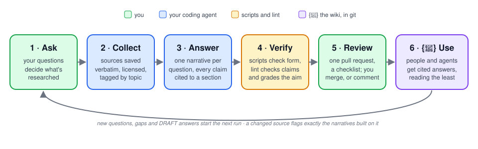
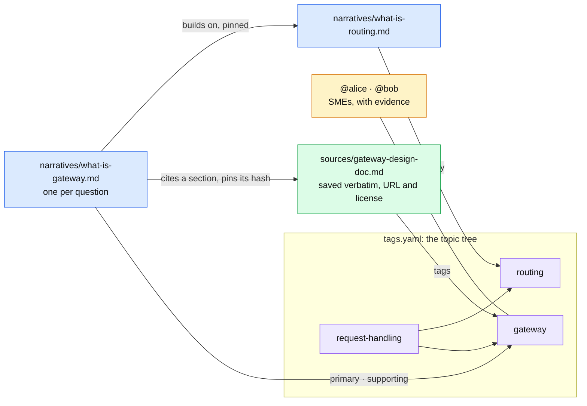
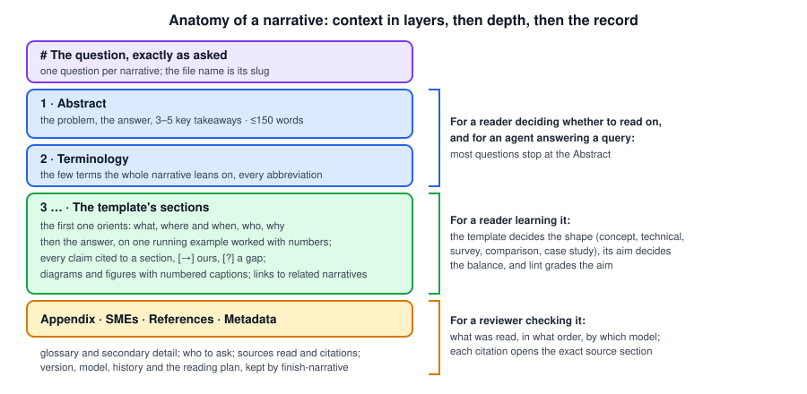
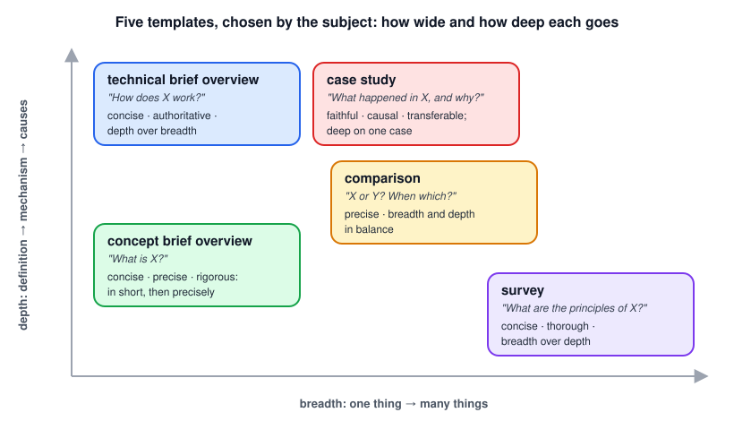
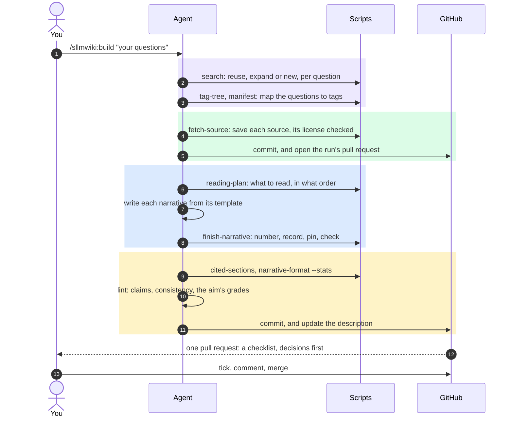
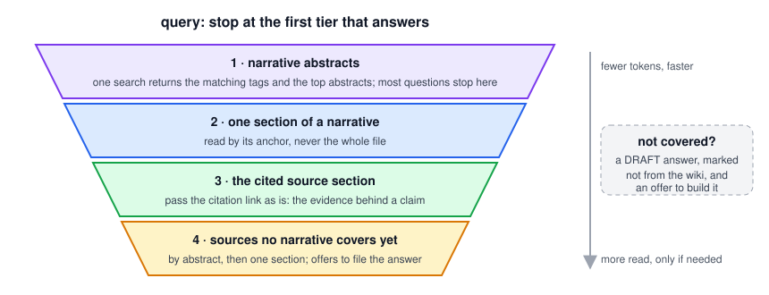
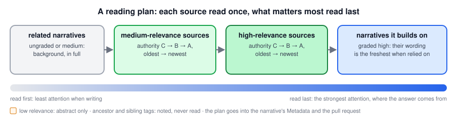
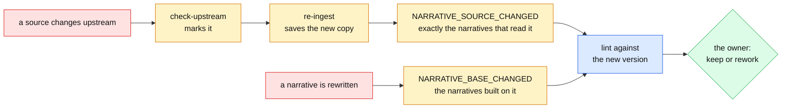

# {📖} Structural LLM Wiki — Design

## 1. Overview

### The problem

Most of what a group knows about its systems isn't written down in one place. Design docs drift from the code, decisions get buried in chat threads and code reviews, and the rest lives in the heads of a few people. New engineers rebuild the same understanding from scratch, and experienced ones answer the same questions again and again.

AI assistants help, but only for the moment. An answer from a chat session is gone when the session ends. Nobody can easily check where it came from, and nothing tells you when it stops being true. So the group's understanding doesn't accumulate.

### The approach

The Structural LLM Wiki gives that knowledge a durable home: a git repository that the coding agent maintains and the group reviews. The work happens in six moves:

1. **Ask.** A run starts from the questions someone wants answered. The questions decide which topics, sources and people matter.
2. **Collect.** The agent finds the sources those questions need and saves them in the wiki, verbatim, so every claim can be checked later. Each source is attached to hierarchical topic tags. The tags connect sources, narratives and the people who know each area.
3. **Answer.** For each question, the agent reads what the question needs, once. Then it writes a narrative that answers the question, with every claim traced to a section of a source.
4. **Verify.** Scripts check everything mechanical. Lint checks each claim against the source section it cites and against related narratives. Lint also grades each narrative against its template's aim. When a source changes, exactly the narratives that depend on it are checked again.
5. **Review.** The run lands as one pull request with a review checklist. The owner comments or merges.
6. **Use.** A person or another agent asks the wiki a question and gets a cited answer. The answer is read from the smallest part of the wiki that answers it: a narrative's abstract, one section, or one cited source section. Or they read the whole wiki as a book: each release attaches it as a PDF, an EPUB or one HTML file (§10).



*Figure 1-1: The knowledge loop. Green is you, blue your coding agent, amber the scripts and lint, purple the wiki in git.*

Each run arrives as a single pull request against the default branch. People stay in control of what enters the wiki without having to do the research. Over time the wiki builds up instead of decaying:

- answers stay linked to their evidence;
- new findings are reconciled with old ones;
- the history shows how the group's understanding evolved.

This document covers the architecture and the decisions behind it. The skill's files are the source of truth for step-by-step behavior: `plugin/skills/sllmwiki/workflows/` and `plugin/skills/sllmwiki/steps/`.

**One skill: workflows made of steps.** The skill has four workflows. `build` builds knowledge (§5), `query` uses it (§6) and `release` publishes it as a book (§10). `init` sets a wiki up and keeps it current. `build` is made of five steps: `tags`, `ingest`, `smes`, `narrative` and `lint`. Each step also runs on its own. A sixth step, `template`, gives a wiki its own kind of narrative (§4.5.5).

The workflows and steps share one data model, one set of scripts and one set of rules, so they live in a single skill. `SKILL.md` routes to a workflow or step file, and the agent reads that file only when it runs. Separate skills would each need their own copy of the shared rules and the data model they describe. An installer copies one skill folder at a time, and a skill can rely only on files inside its folder.

## 2. Principles

- **The wiki is a dedicated git repository.** Git provides history, review and rollback.
- **Two kinds of content: sources and narratives.** A *source* is a verbatim copy of existing material: code, a design doc, a specification, a paper, a book, a web page. A *narrative* is an account of connected facts and claims, told in order, that answers one question: what happened, or how does this work? The emphasis is on telling, and the teller stays out of the way. A narrative presents what its sources establish, in the order that teaches it. It doesn't present the writer's own position.
- **Sources are ground truth.** Sources are saved verbatim (§4.3) and never summarized or edited. Narratives are built from them and checked against them.
- **Every claim is traceable.** A claim in a narrative takes one of three forms:
  - it cites a section of a saved source with a numbered link: `claim [\[3\]](../sources/<file>.md#<section>).`;
  - it is marked as the narrative's own reasoning (`[→]`);
  - it is marked as a gap the sources don't answer (`[?]`).

  A citation sits inside the sentence, as in a paper, and several citations are separated by commas. Their brackets are escaped so Obsidian doesn't read `[[3]]` as a wikilink. §4.10 defines the markers, and how a wiki turns them off.
- **The question drives the run.** Tags, sources and the reading plan are chosen for the questions asked, not for a topic in general. So nothing is collected that no answer uses.
- **Runs are unattended; review happens on one pull request.** A run takes its questions at the start and doesn't pause. What the run can't decide goes to the top of its pull request. The owner reviews, ticks the review checklist and merges.
- **Build on what exists.** One narrative per question. Before writing, look for a narrative that already covers the question, and reuse or expand it (§7.4).
- **Store facts, derive the rest.** Manifests hold only what no file can tell:
  - where a source came from, and when;
  - its license, its tags and its abstract;
  - which source versions a narrative was built from, and which narratives it builds on.

  Sizes, hashes, titles, versions and dates are read from the files when needed. Generated pages (the index, tag pages) are rewritten by every script that writes a manifest, and by `sllmwiki wiki-check --fix`. Nothing derived is stored, so nothing derived can drift.
- **Spend tokens on judgment, and keep attention on what matters.** The agent never does the same work twice and never reads more than the task needs:
  - **Repetitive work is a script's.** Scripts do the counting, hashing, numbering and formatting. They assemble commit messages and PR descriptions, and they check structure. Scripts cost no tokens and give the same answer every time.
  - **Read the smallest part that answers.** Abstracts before sections, a section before a whole file, search results instead of browsing. Scripts print compact findings, not file contents.
  - **Read each source once per run.** Ingest reads a source to write its abstract. The narrative step reads what its plan says, once. Lint reads only the sections the narrative cites (§7.3).
  - **Do nothing twice.** What a run works out once (the tag classification, the reading plan) is carried forward. An unchanged source isn't re-read. Only the narratives pinned to a changed source are rechecked (§7.2).
  - **Load instructions only when they run, within a budget.** `SKILL.md` routes. A workflow or step file is read only when it runs. Every instruction file has a word budget that a test enforces (§9).
  - **Keep the right attention.** The context holds what the question needs, with the most relevant, authoritative and newest material last (§7.1). Parent and neighboring topics are noted, not read.
- **Say each rule once.** Every rule has one home (§9), and other files point to it.
- **Readable where people read.** Plain markdown renders the same on GitHub, in Obsidian and in the book renderers (§4.8). There is no export step and no second copy.
- **Only what's used.** A setting exists only when it meets three conditions (§4.9):
  - a real wiki or a group's policy needs it;
  - it has a safe default;
  - a script enforces it.

  An add-on is off until a wiki turns it on, and it costs nothing while off. No migrations, and no states a real wiki hasn't needed (§12 lists what waits).
- **Tool-neutral.** The workflows name capabilities (docs search, code search, page fetch, git history) rather than specific tools.

## 3. Layout

**This package** (the `sllmwiki` plugin, in the `structural-llm-wiki` repository):

```text
structural-llm-wiki/
├── .claude-plugin/marketplace.json        # makes this repo a plugin marketplace; lists plugin/
├── plugin/                                # the plugin: instructions only (issue #145)
│   ├── .claude-plugin/                    # plugin.json (the manifest) and icon.png
│   ├── skills/sllmwiki/                   # the one skill
│   │   ├── SKILL.md                       # routing and the rules every run shares
│   │   ├── workflows/                     # build, query, release, init: read when the workflow runs
│   │   └── steps/                         # tags, ingest, smes, narrative, lint, template: read when the step runs
│   └── commands/                          # Claude Code commands, one per workflow: init, query, build, release
├── pyproject.toml                         # builds the sllmwiki package; lint and coverage settings
├── tests/                                 # unit tests for the package, and the instruction budgets
├── src/
│   ├── sllmwiki/                          # the package: `sllmwiki <command>`, each documented by its --help
│   │   ├── cli.py                         # the one command, dispatching to commands/
│   │   ├── commands/                      # one module per command (wiki-check, publish, book, …)
│   │   ├── lib/                           # shared modules
│   │   └── templates/                     # narratives/ (templates and guides); languages/ (language packs); book/ (Sphinx's conf.py and stylesheets);
│   │                                      # wiki/ and the *.yml workflows (what init installs)
│   ├── actions/                           # GitHub actions a wiki's CI calls, fetched from this repository at the tag:
│   │                                      # wiki-checks, review-checklist, release-book; they run the package from there
│   └── tools/                             # development and CI tools (eval-plugin.sh, check-yaml, check-book)
├── evals/                                 # behavior evals, run through src/tools/eval-plugin.sh
└── docs/
    ├── images/                            # this document's and the README's figures
    ├── manual.md                          # using the plugin, after the README's setup; an FAQ
    ├── structural_llm_wiki_design.md      # this file
    ├── skill_execution_plan.md            # how it is built
    ├── book_design.md                     # the book a release attaches (§10)
    └── book_execution_plan.md             # how the book was built
```

**A wiki repository** (created by `init`), always laid out the same way:

```text
<wiki-repo>/
├── README.md                 # what this wiki is, how to use it, and its marker convention (§4.10)
├── AGENTS.md                 # rules for agents working in this repo
├── CLAUDE.md                 # imports AGENTS.md for Claude Code
├── .gitignore
├── .claude/settings.json     # offers the sllmwiki plugin to the group's members
├── .github/workflows/        # wiki-checks.yml; review-checklist.yml (red until a run PR's boxes are ticked); release-book.yml (§10)
└── sllmwiki/                 # everything the skill keeps: the knowledge, also the Obsidian vault and a book's source
    ├── Config.toml           # optional: the wiki's settings and add-ons (§4.9)
    ├── .SLLMWIKI_INDICES.md  # generated: a clickable map of the tag tree, for GitHub
    ├── .obsidian/graph.json  # with the Obsidian add-on: written once by init
    ├── tags/
    │   ├── tags.yaml         # the tag tree
    │   └── <tag>.md          # generated: a page per tag
    ├── sources/              # sources, saved verbatim
    │   └── manifest.yaml
    ├── narratives/           # narratives, one per question
    │   ├── figures/<slug>/   # figures a narrative generates (§4.5.3)
    │   └── manifest.yaml
    └── .templates/           # optional: the wiki's own narrative templates (§4.5.5) and languages/ packs (§4.9)
```

Only what GitHub and agents look for at a repository's root stays there: the README, `AGENTS.md`, `CLAUDE.md`, `.gitignore`, `.claude/` and `.github/`. Everything else is in `sllmwiki/`. What isn't knowledge stays out of Obsidian and the book:

- the index and the templates have dot names, which Obsidian ignores entirely (file list, graph, search) while GitHub shows them;
- Obsidian doesn't show a `.toml`.

The layout is fixed. The scripts know it, and no setting changes it. A repository is a wiki when `sllmwiki/tags/tags.yaml` exists. Otherwise every workflow but `init` stops and points to `init`.

## 4. Data model

A wiki stores three kinds of record: topic tags (with their SMEs), sources and narratives. Figure 4-1 shows how they connect, and the sections below define each.



*Figure 4-1: The data model. Tags (purple) connect sources (green), narratives (blue) and the people who know each area (amber); a narrative cites sections of its sources and pins the versions it read, and pins the narratives it builds on.*

### 4.1 Topic tags

A **topic tag** connects sources, narratives and people.

- One source or narrative has one or more tags; a tag has many sources, narratives and SMEs.
- Tags form a tree. Sources and narratives attach to the **most specific tag they are about**. A parent tag holds what covers it as a whole. Giving a tag a child moves nothing.

For a question, each tag it touches is either **primary** (its core topic, read last) or **supporting** (related context, read first). The narrative's manifest entry records which. A tag's **ancestors** and **adjacent** tags (its siblings) are derived from the tree when needed. They are noted, never read, and never stored.

### 4.2 `tags.yaml`

```yaml
request-handling:
  description: "Components that receive, route and serve requests"
  parent: null
  order: 1                                 # its place among its siblings, here the roots

gateway:
  description: "The gateway service: routes incoming API requests to the right backend"
  parent: request-handling
  smes:
    - "@alice: wrote the design doc; 45% of router.go"
    - "@bob: 30 commits in the last 3 months"
```

A tag stores only its description, its parent, its place among its siblings and its SMEs. Its children, sources and narratives are derived. Children come from `parent`, and sources and narratives from the manifests' `tags` fields. `tag-tree` answers questions about the tree, and `sllmwiki manifest add-tag`, `put-tag`, `move-tag` and `order-tags` write it. So the YAML is never edited by hand.

**Reviewing the tree** (issue #204). Each run adds a tag under whichever parent fits that run, so nothing used to look at the whole tree: tags landed where a reader wouldn't look, and roots came in the order they were made. A run that adds a tag now ends with a review (`steps/tags.md`): `sllmwiki tag-tree review` shows the whole tree and lists:

- a leaf no narrative has as a primary tag (`TAG_NO_PRIMARY`);
- a tag most of whose narratives have their other primary tags under another root (`TAG_OTHER_ROOT`, also a `wiki-check` warning, since a tag with no narrative yet is normal mid-way through a run);
- a tag most of whose subtree's narratives link to, build on or need narratives under another root (`TAG_BUILDS_ON_ROOT`);
- with `--new`, the narratives not filed under a new tag that link to its narratives or name it (`TAG_RETAG`).

The owner's dry run showed why the last two are needed. A root added before the field it belongs to (`large-language-models` before `machine-learning`) was never flagged: the tags step only looked up for a parent, and narratives written before a tag existed never got it, so their primary tags couldn't show it. Links, `built_on` and prerequisites between narratives do show it. So the tags step also looks down when it adds a tag, a root above all, and adds a new tag to the narratives that use its subject. The agent checks each new tag's parent against its siblings and its narratives' subjects, and moves a tag with `move-tag`, never by hand. Siblings, the roots included, come in the order `order-tags` sets, then in file order, in the index, the tag pages and `tag-tree`; the owner orders the roots from foundations to what builds on them. A tree can't show what to read first across areas: that is the prerequisites' job (§4.5.2).

**Schema.** `tags.yaml` and both manifests have a schema (`lib/schema.py`). The schema gives each field's kind, whether it is required, and rules across fields. `wiki-check` reports four kinds of field as errors: missing, unknown (with a did-you-mean hint), mistyped and invalid. The wiki's CI then fails the pull request.

### 4.3 Sources and `sources/manifest.yaml`

A source is a verbatim copy of existing material. The wiki keeps it so that every claim built on it can be checked against the original's own words. Each kind of source is saved as the most faithful text that can be checked:

| Kind | Saved as |
|---|---|
| `text` | markdown or plain text, byte for byte; a plain-text standard (an RFC, three or more numbered sections) with its numbered sections as headings, each section verbatim in a fenced block, its page headers and footers left out; reStructuredText with its section titles as headings, the rest byte for byte |
| `html` | the page's main content (`<main>` or `<article>`, without navigation, comments, scripts or headings' permalink marks) converted to markdown by a small converter: headings, paragraphs, lists, tables, code, links. Images stay links to the original |
| `pdf` | the text layer, with the PDF's own outline (its bookmarks) as the headings, so sections and citations follow its chapters and sections; `## Page <n>` headings only for a PDF without an outline |
| `epub` | the book's chapters in its reading order (its spine), each converted like an HTML page, its headings set at the depth its table of contents gives it; links within the book keep only their text, images their alt text. A book whose chapters are encrypted (DRM) is refused, never decrypted |
| `tex` | a LaTeX source's body: its sections as headings, its math kept as TeX (`$…$`, `$$…$$`), its formatting as markdown, the rest of its markup dropped; `\input` files read from beside it |
| `code` | a code file verbatim in one fenced block, so a citation names its lines as the file numbers them: `#L10-L20` |
| `link` | nothing: a pointer (live code, dashboards, a source that may not be copied); `sllmwiki manifest put-source --kind link --drop-copy` turns a saved copy into one in place |

Each saved file ends with a generated "Original source" footer (its URL and license). The footer is left out of the file's hash. The manifest has one entry per source, keyed by slug (`<topic>-<source-name>`):

```yaml
gateway-design-doc:
  file: sources/gateway-design-doc.md      # absent for a link
  kind: html
  url: https://docs.example.com/gateway/design
  published: "2026-07-13"                  # the source's own date, when it has one
  ingested: "2026-07-14"
  license: "CC-BY-4.0"                     # SPDX id, or "unknown" or "proprietary"
  license_url: https://docs.example.com/license
  # permission: "Jane Doe, 2026-07-14: may keep a copy"   # only with --allow-restricted
  tags: [gateway, routing]
  abstract: "Original gateway architecture and design rationale. …"   # 150–250 words
```

The file's size and hash are read from the file. A source is **stale** when `check-upstream` fetches it again and the content differs from the saved copy. A stale source is marked with `upstream_changed: "<date>"` until it is re-ingested. A large source is saved like any other and listed with its size in the run's pull request. Reading by section (§6.1) keeps its size from mattering.

**Large outlined documents are sliced by chapter.** Reading by section makes a file's size harmless. But the agent chooses what to read by abstract, and one abstract is too coarse for a book. So a PDF over 100 pages that has an outline is saved as one source per top-level outline entry (`<slug>-<n>-<chapter>`, its URL ending `#page=N`). Each slice is tagged on its own.

An EPUB over 40,000 words, about as much text, is sliced by its table of contents the same way (`#chapter=N`). Two rules fit the shapes real EPUBs have:

- An entry still over 40,000 words is cut by the entries under it, run together up to 40,000 words. Moby-Dick's 135 chapters, all under one "Moby Dick" entry, make six slices, not one or 135.
- Front or back matter under 500 words joins its neighbour.

Shorter documents, and documents without an outline, stay one file. A slice starts with a script-written abstract (its title and opening paragraph, `abstract_draft: true`), which costs no tokens. The agent replaces it with a real abstract only when a question first reads the slice.

### 4.4 Narratives and `narratives/manifest.yaml`

```yaml
what-is-gateway:
  template: technical_brief_overview
  tags:
    primary: [gateway]
    supporting: [routing]
  read:                                    # the source versions the narrative was built from
    gateway-design-doc: 9f8e7d6c5b4a…      # MD5 of the saved file, without its footer
  grades:                                  # the reading plan's grades (§7.1)
    gateway-design-doc: {relevance: high, authority: A}
  models:                                  # the model that wrote each version
    '1.0': claude-opus-5-5
  built_on:                                # the narratives it builds on, by a hash without their Metadata
    what-is-routing: 3c2b1a0f9e8d…
  prerequisites:                           # the narratives a reader reads first, pinned the same way (§4.5.2)
    what-is-a-gateway: 5e4d3c2b1a0f…
```

The question (the title), the Abstract, the version and the dates live in the narrative and are read from it. The grades and models are the record behind the narrative's Model and Reading plan. `finish-narrative` writes both into the narrative's Metadata. A reader then sees what was read, in what order and why, and which model wrote the narrative.

`finish-narrative` also writes the narrative's length and reading time: `- **Words:** 1,240 (about 5 min)`. The count covers everything but code, diagrams, References, SMEs and Metadata. It assumes 230 words a minute, and CJK text counts 1.6 characters a word. `narrative-format` warns (`WORDS_OUTDATED`) when an edit left the count stale. The tag pages and the book show the minutes beside each narrative.

When a source is re-ingested and its hash no longer matches a pin, `wiki-check` reports `NARRATIVE_SOURCE_CHANGED` for exactly the narratives that read it. A narrative also pins the narratives it builds on, those its reading plan graded high. The pin works the same way (`built_on`), by a hash of each one's content without its Metadata. When one of them is rewritten, `wiki-check` reports `NARRATIVE_BASE_CHANGED` for the narratives that rely on it. The hash also leaves out heading numbers, blank lines and what `finish-narrative` generates from other narratives (§4.5.2), so a renumbering or another narrative's new prerequisite isn't a change. Pins written before that, which kept the numbers, still match until the narrative is finished again.

### 4.5 Narratives

A narrative presents an account of connected events, facts or claims, told in order. It answers "what happened, or how does this work?" Its emphasis is on telling. The narrative stays out of the way and lets the sources' facts carry the account. What it adds is the telling itself:

- the order;
- the running example;
- the reasoning that connects one cited fact to the next, which it marks as its own (§4.10).

Each file in `narratives/` answers one question, and the question is the title, unchanged.

#### 4.5.1 Structure

Every narrative has the same top and appendices, defined once in `templates/narratives/shared.md`. In order:

1. an **Abstract**: one sentence on the problem, the answer in two or three, then 3–5 key takeaways; 80–150 words;
2. a small **Terminology** table of the terms the whole narrative leans on, and every abbreviation;
3. the body;
4. an optional **Appendix**: Before you read and Where to go next (§4.5.2), the Glossary, and details and examples a reader may want but doesn't need to follow the answer;
5. **SMEs**;
6. **References**: sources read, code references, related narratives, citations;
7. **Metadata**: version, template, model, history, reading plan.

Every heading of level 2 to 4 is numbered (`## 1. Abstract`, `### 5.1 …`).

The shared writing guide holds the style every narrative shares. It states each rule once, in priority order:

1. context once, in layers: the Abstract for a reader deciding whether to read on, the first section's orientation, the running example's scene, the big picture, each section's opening;
2. the concepts planned in dependency order;
3. plain sentences;
4. ideas before sources;
5. one or two key examples carried through the sections;
6. a shape that fits the content;
7. detail in its place.

A template's guide adds only what its kind of narrative needs.



*Figure 4-2: Anatomy of a narrative. Blue is for a reader deciding whether to read on, and for `query`; green for a reader learning the subject; amber for a reviewer checking it.*

**Orientation.** Every narrative's first section orients the reader in a few sentences before any definition or mechanism: what the subject is, where and when one meets it, who deals with it, and why it matters.

#### 4.5.2 Links between narratives

Sometimes a narrative mentions a concept that another narrative covers. It then links to that narrative, to its section where one fits. It says the concept in a sentence at most instead of explaining it again. So the wiki says each fact once, and its narratives connect.

Section anchors carry the section's number. `narrative-format` and `wiki-check` report a link to a section that isn't there (`NARRATIVE_ANCHOR`). `finish-narrative`, `wiki-check --fix` and `prerequisites migrate` repair a link whose section was only renumbered, matched by its title, a link to one of the narrative's own sections included. `migrate` once left 19 such links broken in a 27-narrative wiki, since moving a body section renumbers every section after it (issue #212).

**Prerequisites.** A link says where a concept is explained; it doesn't tell a reader what to read first. A narrative records its prerequisites: the narratives whose concepts it uses without explaining them, its direct ones only (`finish-narrative --prerequisite`, issue #205). They aren't `built_on`, the writer's record of what it read: a writer may read a narrative a reader doesn't need first, and a reader may need one the writer never graded. The writer chooses them after writing: each term or idea used without a definition, and the narrative that defines it. `sllmwiki prerequisites propose` lists the evidence (`built_on`, links, terms another narrative defines), and lint checks it both ways: a term another narrative explains with no prerequisite on it, and a prerequisite the narrative never uses.

From them, `finish-narrative` and `wiki-check --fix` write, between generated markers, the Appendix's first two subsections: **Before you read**, the prerequisites, and **Where to go next**, the narratives that list this one as a prerequisite, each with its question, its first key takeaway and its reading time. After the markers come the writer's own next reads, the questions this one opens, kept on every rewrite. The line under the title points to the prerequisites too (`*About 9 min read. Read first: [A](a.md) ([Before you read](#81-before-you-read)).*`), since a reader needs them before the body, not after. The generated parts count neither as words nor as a change (§4.4), so a narrative that gains a dependent doesn't flag the narratives built on it. `wiki-check` reports a prerequisite that isn't a narrative (`PREREQUISITE_UNKNOWN`), a cycle (`PREREQUISITE_CYCLE`), one another prerequisite already needs (`PREREQUISITE_INDIRECT`), one rewritten since (`PREREQUISITE_CHANGED`) and stale generated parts (`READING_ORDER_OUTDATED`). A wiki from before moves each body section "Where to go next" into its Appendix and records its prerequisites once, through `sllmwiki prerequisites migrate`, in the `init` rerun's pull request.

A narrative never states its own place in a reading order (issue #213). Narratives written before prerequisites often did: "the first of three foundations narratives, read in order", a numbered list of links, "read before this one". One such order was too strict, since the later narratives each needed only the first. Another was stale, written before three more narratives joined the series. A hand-written order drifts as narratives are added; the generated one doesn't. So `narrative-format` warns on such a passage in the narrative's own sections, from the Abstract up to the Appendix (`READING_ORDER_IN_BODY`): a phrase that places it in an order, in English, or a numbered list whose items are mostly links to other narratives, in any language. `migrate` lists the same passages. The writer records the order as prerequisites and removes the statement, keeping the content around it, such as the example it sets up or a link that explains a concept.

#### 4.5.3 Figures

A picture is the writer's judgment, not a quota (`shared-guide.md`, Pictures):

- one where it helps the reader learn most (the big picture, the running example step by step);
- more only when each teaches something new;
- none when it would only decorate.

A picture makes claims. So its caption carries the citations for what it shows, and lint checks the picture against them.

A picture comes in whichever of the wiki's `picture_formats` shows its idea best, none of them first:

- **A mermaid diagram,** text each viewer draws, for structure and flow in a standard shape.
- **A figure the narrative generates,** for a curve, measured data, geometry or a layout mermaid would crowd. The figure is computed from the narrative's own formulas, cited numbers or structure, never copied from a source.

A generated figure is an SVG, or a PNG only for what SVG can't hold. SVG and PNG are the two formats that GitHub, Obsidian, mdBook and Sphinx all show. The figure lives in `narratives/figures/<slug>/`. It is kept small for the agents and books that carry it: under `max_image_kb` (100 KB by default), and a PNG at most 1600 px wide.

A wiki sets which kinds of picture it takes (`picture_formats`, mermaid, SVG and PNG by default). It also sets how many a narrative may have (`max_pictures`, 5 by default). `picture_formats = ["mermaid"]` (§4.9) keeps a wiki to mermaid.

Every diagram and figure has a caption line under it, `*Figure 5-1: what it shows.*`, numbered by its section. The caption and the alt text say what the picture shows, so no agent needs to open the picture. The scripts check the rest:

- `finish-narrative` renumbers the captions and the references to them.
- `narrative-format` checks a figure's place, format, alt text and size, and every caption. It also checks that an SVG is self-contained and has an opaque background for dark themes.
- `wiki-check` reports a figure no narrative shows.

Narratives are written in plain sentences (`shared-guide.md`, Plain sentences): one point per paragraph, in its first sentence; who does what first; one idea per sentence; exact words, and numbers rather than adjectives; and a name rather than an "it" the reader must resolve. The guide states each rule as what to do, not what to avoid. On an English narrative, `narrative-format` checks the parts a script can find without judging (`lib/plain.py`):

- a sentence over 30 words (`SENTENCE_LONG`);
- a filler phrase such as `in order to` or `this section explains`, a redundant pair such as `each and every`, a modifier the word implies such as `end result`, `I think` before a claim, or a point announced, such as `I want to point out that` (`SENTENCE_FILLER`);
- a trailing `, allowing …` clause (`SENTENCE_TRAILING`);
- an "it" or bare "this" with nothing clear to point at (`SENTENCE_REFERENCE`);
- a vague word such as `thing` or `very`, or a qualifier a number should replace, such as `significantly` or `recently`; `often`, `soon`, `better` or `faster` only in a paragraph with no number, since one there usually gives the measure (`SENTENCE_VAGUE`);
- an authority with no name, such as `experts agree` (`SENTENCE_UNSOURCED`);
- an abbreviation not spelled out at its first use outside the title and Terminology, other than general computing ones such as `CPU` (`ABBREV_UNDEFINED`), and its spelled-out words written again after it (`ABBREV_LONG_FORM`);
- more than 15% of a narrative's sentences in the passive, once it has 20 (`PASSIVE_SHARE`). A single passive sentence is sometimes right, so only the share is reported.

On any narrative, `narrative-format` also warns on a mermaid `pie` (`CHART_PIE`) and on an `xychart` axis with no title (`CHART_AXIS`). Lint judges what a script can't: a paragraph whose point isn't its first sentence, a number with no baseline, three or more numbers compared outside a table, thin or contrary evidence left unsaid, an SVG chart without units.

These findings are warnings, since a long sentence is sometimes the clearest one. Lint's Reader check judges the rest: passive voice, nested clauses, noun stacks.

A narrative describes how its subject works before any "why", and its big picture fits the subject: a map of the parts for a structure, the steps in the order they happen for a process. Headings say what their section explains. A question the reader would ask is answered in its section, or in an Appendix FAQ, and `narrative-format` warns on a question as a `###` or `####` heading outside the Appendix (`QUESTION_HEADING`). Question headings had come from an older rule that made each concept the answer to the reader's next question (issue #188). Reworking a narrative after a guide change plans it again: an outline kept from the old version kept its question headings.

A narrative is one story, not a stack of sound sections (issue #194). Every other writing rule is local to a sentence or a section, so the writer first writes a spine: the answer as one paragraph of 5–8 sentences on the running example, each following from the one before. Each section expands one of its sentences, in order, and ends with the state or question the next starts from. The concept plan, which had ended up as the outline, only checks that each concept arrives by the time the spine needs it. The explanation is written first and cited after, so a cited fact the spine doesn't need leaves the body. In the technical template, the tool or system a question is about is introduced upfront and leads every step, and each step is a handoff: who acts, where, on what, producing what for whom. Lint's Reader check reads the whole: one sentence per section, in order. The run's summary carries the spine, so the reviewer sees the thread the narrative was written from.

#### 4.5.4 Templates

A template is a folder with `template.md` and `guide.md`. The skeleton in `template.md` is the schema:

- its headings are the required sections, in order;
- a heading ending in `(optional)` may be left out;
- a section holding a `<picture: …>` line needs a picture. The line says what the picture must show and the kinds that fit. The writer picks the format, among `picture_formats`, that shows it best.

A short YAML header gives `description`, `use_when`, `max_words` (the body's budget) and `abstract_words`.

The guide holds the style. Its sections are audience and purpose with its aim, voice and tone, structure, evidence, length, checklist, and, for the bundled templates, examples. Every template's guide is written for a reader new to the topic: the problem before the mechanism, prerequisites before use, one notation throughout, rules of thumb for every parameter. The guide's Examples section says where the narrative's one or two key examples appear in each of its sections. So the reader never switches context to follow a point.

A template is chosen by the subject, not the question's wording:

| Template | Subject | Focus | Takeaway: a reader new to the subject … | Budget |
|---|---|---|---|---|
| `concept_brief_overview` | A concrete subject that has a concise, precise definition | A short overview (what, where and when, who, why); the definition in short, to set the intuition, then precisely, from the source that defines it most exactly, with the nuances that adds; its consequences; and its edge cases | has learned the concept | 1,200 words |
| `technical_brief_overview` | A solution, an algorithm, or the design of a component or for a problem | How it works: the core idea and its picture first, then a walkthrough on one running example, then variants and trade-offs | has learned the solution or design | 1,800 words |
| `comparison` | A choice among common candidates | Each candidate in turn on one base scenario, a condition changed until it wins; then when to pick which, and every dimension to think through | knows each candidate, what sets it apart, and which one their situation calls for | 1,500 words |
| `survey` | Anything not concrete: a domain, or an umbrella term for subtopics or directions that each go deep their own way | Wide over deep: the main dishes on the table that one can't miss, an overview with context and scope, the items grouped and mapped first, their tensions, classic case studies, where to go deeper | knows the main areas of the domain and where to go deeper in each | 2,200 words |
| `case_study` | One real, documented instance a concept or domain is known by: an incident, a production system, a design decision | Deep on the one case, in one of two shapes (an incident's timeline, a decision's options): its context, what happened, why (the causal chain), the ideas at work (linked to their narratives), the lessons that carry over | knows what happened and why, and can apply its lessons elsewhere | 1,500 words |

Four are shown in the [demo wiki](https://github.com/mengjiasun1992/sllmwiki-demo): [concept](https://github.com/mengjiasun1992/sllmwiki-demo/blob/main/sllmwiki/narratives/what-is-a-distributed-system.md), [technical](https://github.com/mengjiasun1992/sllmwiki-demo/blob/main/sllmwiki/narratives/what-is-an-ewma-exponentially-weighted-moving-average-and-how-does-it-work.md), [comparison](https://github.com/mengjiasun1992/sllmwiki-demo/blob/main/sllmwiki/narratives/when-should-software-use-an-ewma-instead-of-other-moving-averages.md) and [survey](https://github.com/mengjiasun1992/sllmwiki-demo/blob/main/sllmwiki/narratives/what-are-the-common-design-tenets-and-principles-for-distributed-systems.md).

**Aims.** Each template names its aim: the few qualities its narratives are graded on. Its guide says what each quality means in practice:



*Figure 4-3: The five templates by how wide and how deep each goes, with their aims.*

| Template | Aim |
|---|---|
| `concept_brief_overview` | concise, precise, rigorous |
| `technical_brief_overview` | concise, authoritative, depth over breadth: the core idea and how it works carry at least half the body |
| `survey` | concise, thorough, breadth over depth: every item the sources agree on, or named as left out |
| `comparison` | precise, breadth and depth in balance: every common candidate, depth only where it decides the choice |
| `case_study` | faithful, causal, transferable; deep on one case: every event cited, the chain from trigger to impact explained, each lesson with when it holds |

Lint grades each narrative on each axis of its template's aim: met, partly or missed, with the evidence. `sllmwiki narrative-format --stats` helps. It reports the body against its budget, the words, citations and markers per section, and the citations by the authority of what they cite.

#### 4.5.5 A wiki's own templates

The five bundled templates cover the common kinds of questions. A group adds its own templates for the kinds they don't fit, such as a postmortem of its incidents, a runbook, or a ten-minute primer on one paper.

- **What it is.** A folder in the wiki's `sllmwiki/.templates/` with a `template.md` and a `guide.md`, the same two files as a bundled template. The wiki's template is offered next to the bundled ones, and the narrative step picks it by its `use_when` like any other. A wiki template with a bundled template's name replaces that template in this wiki.
- **How it's made.** Asking for one ("make a template for <what it's for>") runs the `template` step. The step:
  1. starts from the closest template (`sllmwiki narrative-format --new-template <name> --from <closest>`);
  2. shapes the header, the sections and the guide from the owner's description;
  3. checks the result;
  4. lands it as one pull request.

  A template can also be written by hand.
- **How it's checked.** `lib/templates.py` checks it the same way as a bundled one:
  - the header's four keys;
  - the guide's six sections, with the **Takeaway** and the **Aim** whose axes lint grades every narrative on;
  - a body of `##` sections, each with its `<…>` line, repeating none of the shared ones.

  `sllmwiki narrative-format --templates` lists every template with its aim and any problem. A template that doesn't load is a problem, not a template. `wiki-check` reports it (`TEMPLATE_INVALID`), as it does a `Config.toml` budget for a template that doesn't exist. The wiki's CI then fails.
- **The same bar as the bundled ones.** Its narratives get the shared top and appendices, citations, markers and finishing, and lint grades them against its aim.
- **Only a different length?** Set the budget in `Config.toml` (§4.9) instead of copying the template.

The [demo wiki](https://github.com/mengjiasun1992/sllmwiki-demo) has one: [`skim_read`](https://github.com/mengjiasun1992/sllmwiki-demo/tree/main/sllmwiki/.templates/skim_read). It is a ten-minute primer on one long work, for a reader from the field deciding whether to read the work in full (aim: faithful, focused, decisive). The demo also has [a narrative written with it](https://github.com/mengjiasun1992/sllmwiki-demo/blob/main/sllmwiki/narratives/what-does-keeping-calm-argue-and-is-it-worth-reading-in-full.md).

#### 4.5.6 What scripts do for every narrative

After any edit, the agent runs one command, `finish-narrative` (§7.5). It:

- numbers the headings and figure captions;
- repairs links to a renumbered section, in another narrative or in this one;
- escapes what the renderers would misread (§4.8);
- writes a typed `[->]` as `[→]`, and adds a Terminology row for each marker the narrative uses (when markers are on);
- keeps the reading-time line under the title, when the narrative has one, equal to Metadata's Words (see below);
- bumps the version and history when asked;
- writes the manifest entry with the current pins of the sources the narrative read, the narratives it builds on and its prerequisites;
- writes Before you read, Where to go next and the Read first pointer, in this narrative and in those its prerequisites changed (§4.5.2);
- regenerates the index and tag pages.

The reading-time line is `*About 5 min read.*`, in the narrative's language. The script keeps its minutes because a hand-kept line drifted on every edit. `narrative-format` reports a stale line (`READING_TIME_OUTDATED`). The word count leaves the line out, and the book drops it for its own line: the date the narrative last changed and its reading time.

The agent writes the content; the script does the rest.

#### 4.5.7 The wiki's audience

Every guide assumes a reader. `shared-guide.md` assumes one from a technical or research field, new to the topic. Each template's Audience and purpose names its own. A group whose readers differ (product managers, new hires, a team that already knows the field) shouldn't have to copy and edit every guide to say so. The audience profile lets the group say it once.

- **What it is.** One markdown file in the owner's words: who reads the wiki, what they already know, what they need from an answer. `Config.toml`'s `audience` names the file (§4.9). Its value is `sllmwiki/.templates/audience.md` by default, any other path in the repository the owner prefers, or `""` for none. The path must stay out of the Obsidian vault, so the profile never shows up among the notes, the tags or the graph. So the file lives outside `sllmwiki/`, or inside it only in a hidden folder (`lib/config.py` checks this).
- **It comes first.** The profile is the first of the rules every run follows (`SKILL.md`). The writing follows it over the skill and every guide, except the rules on sources and pull requests. The source policy, sources as data, and one reviewed pull request per run stay above the profile. Three commands print it:
  - `sllmwiki narrative-format --guide <template>` prints it before the template's guide, `shared.md` and `shared-guide.md`. That order keeps the shared guide's rule that the earlier of two rules wins.
  - `sllmwiki search context`, a query's first call, prints it before the tags and narratives, so an answer is written for the profile too. A rule in `SKILL.md` alone didn't make queries read it.
  - `--audience` prints it alone.

  Lint's Reader check grades a narrative against the profile, together with the guides.
- **At most 1000 words.** The profile is loaded on every narrative a run writes, on top of the guides' own budgets (§9), so it stays short. `wiki-check` reports a profile over budget (`AUDIENCE_TOO_LONG`), which fails the wiki's CI. It counts words as `narrative-format` counts them, with CJK characters at 1.6 to a word. `--guide` still prints an over-budget profile, with a warning, so a run isn't stopped.
- **Empty until the owner fills it in.** `init` creates the file at its path with a heading and a comment saying what goes there, and never overwrites it. A file with only headings and comments says nothing, and the skill writes for the guides' readers. On a first setup `init` asks who the wiki is written for. Later, asking ("write this wiki for our product managers") runs the `template` step, which fills the profile in one pull request. The profile can also be written by hand.

### 4.6 Why YAML

YAML is human- and model-readable, `grep`- and `yq`-friendly, and diffs cleanly in review. A database would hide changes from review and from the model. The skill reads YAML with a narrow subset reader (`lib/wikiyaml.py`). The reader covers exactly what the skill's writers produce and fails loudly on anything else. The skill writes YAML with targeted line edits that keep comments and order. The expected scale is tens to low hundreds of sources per wiki.

### 4.7 Source policy

The wiki keeps verbatim copies, so the skill follows a source policy ("Source policy" in `SKILL.md` is its one home):

- **Copyright** stays with each source's authors, and a copy transfers no rights. Narratives are original writing with brief, attributed quotations: at most `max_quote_words`, 50 by default, checked by `narrative-format`.
- **Attribution:** every saved source keeps its URL and license in its footer and manifest entry.
- **Access controls are never bypassed:** no logins, paywalls, registration walls or anti-bot protection, and no unofficial copies. A rate limit (HTTP 429) is a request to wait, not a refusal. The fetch is retried up to three times with exponential backoff and jitter, honoring a `Retry-After` of up to a minute. After that, the source is recorded as a link.
- **What may be copied depends on who can see the wiki.** A private repository keeps reference copies unless a source's terms forbid sharing. A public one keeps only openly licensed sources (`OPEN_LICENSES` in `lib/policy.py`):
  - public domain and CC0;
  - Creative Commons BY and BY-SA;
  - the permissive and weak-copyleft code licenses: MIT and MIT-0, Apache, BSD and 0BSD, ISC, zlib, Boost, the MPL, EPL, EUPL, CDDL, PSF, Artistic, Unicode, OFL and others;
  - open data licenses: ODC-By, ODbL, PDDL, CDLA-Permissive;
  - the GNU GPL, LGPL and AGPL, whose verbatim copies keep their notice;
  - RFCs (`LicenseRef-IETF-Trust`). The IETF Trust lets anyone copy an RFC in full and without modification. A saved RFC keeps every word, leaving out only its page breaks and page headers and footers.

  Non-commercial and no-derivatives licenses (CC BY-NC, BY-ND) and the GFDL stay links, for three reasons. A company wiki isn't clearly non-commercial. A saved copy gets a footer. The GFDL wants its whole text with every copy. A US federal government work is `public-domain`. A contractor's or a state's work is not, nor what a federal work quotes from others. Anything else is a `link`. A group whose policy allows no copies at all sets `source_copies = "links-only"` (§4.9), and every source is a `link`.
- **No personal data or secrets,** whatever the license. Sections holding them are left out with a marker, never edited.

The judgment is the agent's. The agent reads the source's license or terms and records them (`--license`, `--license-url`). The scripts enforce what can be checked:

- `fetch-source` asks GitHub whether the repository is public. It asks through `gh`, or else through the public API, where a 404 means "can't say", not "private". GitHub hides a suspended or flagged account's public repositories too.
- `fetch-source` refuses to save a copy whose recorded license isn't open in a public wiki. `--allow-restricted "<who, when>"` records the owner's permission instead, as the source's `permission`. Under `links-only`, `fetch-source` refuses any copy at all.
- `wiki-check` fails the wiki's CI (`SOURCE_POLICY`) on any saved copy a public wiki may not hold, and on any saved source without its URL and license.

GitHub can't say when the wiki is on another host, when `gh` is signed out, or when GitHub is unreachable. The wiki then counts as public, unless `Config.toml`'s `visibility` declares it private (§4.9). A declaration never loosens what GitHub shows. A repository GitHub shows as public is public whatever `visibility` says, and `wiki-check` reports the contradiction (`VISIBILITY_MISMATCH`). A private repository declared public follows the public policy, to stay ready to publish.

### 4.8 Markdown everyone renders alike, and Obsidian

A wiki is read on GitHub page by page and opened in [Obsidian](https://obsidian.md) as a graph. It can later be built as a book with mdBook or Sphinx and MyST-Parser. Its markdown keeps to what all four render alike, as `lib/compat.py` defines it:

- markdown links relative to the linking file, spaces as `%20`, links to files not folders;
- no wikilinks, embeds, highlights, `%%` comments, block IDs or inline `#tags`;
- only GitHub's five alerts as callouts;
- `$$` math only where GitHub renders it unchanged;
- escaped citation brackets;
- no bare URLs;
- escapes for what a book reads as its own syntax: a `%` starting a line, `{…}` ending a heading, `$` before a number, single tildes, `{{#include …}}`.

Code is never checked or escaped. Each rule was checked by rendering in the renderers, and `test_compat` holds the evidence (`AGENTS.md`, "Markdown compatibility"). `narrative-format` checks narratives. `wiki-check` checks every page under `sllmwiki/` but the saved sources. `finish-narrative` writes the escapes.

The wiki's CI also runs markdownlint, with rules that catch markdown that renders wrong. When Node is installed, `wiki-check` runs the same markdownlint version with the same settings. The settings are `templates/markdownlint/` in the package, the one copy the CI action and this repository use too. So what CI would fail on shows up before a push. Without Node, `wiki-check` warns that CI will run markdownlint (`MARKDOWNLINT_SKIPPED`). `SLLMWIKI_MARKDOWNLINT=off` turns the check off.

**Tag pages, for everyone.** A script generates a page per tag: description, parent, children, narratives, sources, SMEs. The tag pages make each topic browsable on GitHub. They also put the tag tree in Obsidian's graph, which draws every markdown file as a node and every link as an edge. The pages are plain markdown, written by a script in milliseconds.

**The Obsidian add-on** (`obsidian = true`, §4.9) adds what only Obsidian uses:

- `init` writes `sllmwiki/.obsidian/graph.json` once, and the wiki owns the file from then on. It colors tag pages gold, narratives indigo and sources gray, and filters sources out of the graph. A reader who wants sources out of search too excludes them in their own `app.json`.
- `.gitignore` shares only that file from `.obsidian/`. With the add-on off, `.gitignore` ignores all of `.obsidian/`, so a reader's own graph is never committed.
- `sllmwiki publish` ignores Obsidian's rewrites of `graph.json`.

With the add-on off, nothing Obsidian-specific is written.

**The index.** `sllmwiki/.SLLMWIKI_INDICES.md` is GitHub's map. It holds a mermaid diagram of the tag tree, and the same tree as a nested list of links to the tag pages. GitHub draws a mermaid diagram in an iframe on another host, where a relative `click` link resolves to a missing page (issue #199). So when origin is on GitHub, each node opens its tag page by an absolute URL, `https://github.com/<owner>/<repo>/blob/HEAD/…`. `HEAD` names the default branch, so a clone and a CI checkout write the same index. Without a GitHub remote the nodes don't click, and the list opens the pages. `wiki-check` and `narrative-format` report a relative `click` link on any page (`MERMAID_RELATIVE_CLICK`). The wiki's README links to it.

**Reading paths** (issue #206). A tag tree is a map, not a path: it says what a narrative is about, not what to read first. So the index adds, under the tree, a numbered **reading path** per root, computed from the prerequisites (§4.5.2) and always current (`lib/readingorder.py`):

- A narrative sits in one path, under its **home**: its most specific primary tag. A primary tag that is an ancestor of another of its primary tags drops out, and the first left wins. Depths in different trees don't compare, so unrelated tags keep the narrative's order. The book files a chapter under the same tag.
- Within a path, each narrative comes after its prerequisites and says which ("needs 1, 3"), with a link to one in another root's path ("needs machine-learning 2"). Ties go by where its home sits in the tree, then template ("what is" before "how does"), then question.
- Roots come in dependency order: a root whose narratives need another root's comes after it, and the owner's order (`order-tags`) breaks ties. The tree above, the paths and the book's parts follow it.
- Each tag page lists its narratives numbered in the same way, primary before supporting on a tie, naming a prerequisite filed under another tag.

A diagram per root was left out: the numbered lists carry the order, and the diagrams mattered mostly for Obsidian.

Obsidian and a book don't need the index. Its dot name keeps it out of Obsidian, where it would link to every tag. A book has its own contents, and in a book a link to the index points to them.

### 4.9 Settings and add-ons: `Config.toml`

A wiki can keep a `Config.toml` in `sllmwiki/`. Every setting has a default, so the file is optional. `init` writes the file with the defaults and a note on each. A rerun adds any setting the file lacks and keeps the wiki's values. On a first setup, `init` asks the owner about the settings they'd want to choose: language, source policy, the book's formats, title and author, Obsidian, markers, figures, who never to list as an SME. On a rerun it asks only about settings added since (`sllmwiki init --ask`, `--set`).

```toml
[structural-llm-wiki-settings]
source_copies = "allow"     # "allow": a private wiki keeps reference copies, a public one only openly licensed sources (§4.7); "links-only": no copies, every source a link
visibility = ""             # "private" or "public": who can see the wiki when GitHub can't say (§4.7); "": ask GitHub, and count as public when it can't say
audience = "sllmwiki/.templates/audience.md"  # who the wiki is written for, before the skill and its guides (§4.5.7); "": none
max_quote_words = 50        # the longest quotation a narrative may take from a source
smes_exclude = []           # never listed as SMEs, such as the wiki's owner or bots: ["@alice", "dependabot"]
markers = true              # false: no [→] or [?] markers (§4.10)
reader_annotations = false  # true: readers' annotations in narratives (§4.10.1)
picture_formats = ["mermaid", "svg", "png"]  # the kinds of picture a narrative may use
max_pictures = 5            # pictures in one narrative, at most; 0: none
max_image_kb = 100          # an SVG or PNG figure's size, at most
language = "en"             # the language narratives are written in, a BCP 47 tag; sources keep their own

[structural-llm-wiki-templates.technical_brief_overview]   # a template's budgets, over its header
max_words = 3000
abstract_words = [150, 300]

[structural-llm-wiki-addons]
obsidian = false            # true: the Obsidian add-on (§4.8)

[structural-llm-wiki-release]
pdf_book = true             # the book a release attaches (§10): a PDF
epub_book = false           # an EPUB, for e-readers and phones
html_book = false           # one self-contained HTML file, for a browser
title = ""                  # the book's title; empty: the repository's name
author = ""                 # its author; empty: the title
```

- **What earns a setting.** A real wiki or a group's policy needs it, it has a safe default, and a script enforces it. Each setting above meets all three:
  - The one real wiki raised a template's budget, set the Obsidian add-on on, and had its owner wrongly listed as an SME.
  - Its owner found the markers cluttering and asked what they meant.
  - `source_copies` and `max_quote_words` are what legal review may need to tighten.
  - `visibility` keeps a private wiki's policy when GitHub can't answer: an account locked for days, or a wiki hosted elsewhere.

  Nothing configures the layout (§3).
- **Language.** Narratives are written in `language`. Each narrative names its own language in its Metadata (`- **Language:** zh-Hans`), which `finish-narrative` writes for every narrative. Sources are never translated, and a quotation keeps its source's words with a translation after it.

  A narrative's headings come from a language pack, and so do the few labels the scripts write (table headers, figure captions, the markers' rows). A pack is `languages/<tag>.md` in the skill's templates or the wiki's `sllmwiki/.templates/`. It is a table from the English text to its translation, bundled or the wiki's own, like a template. A pack may end with a `## Writing` section of its language's rules, which `--skeleton` points the narrative step to. Chinese's rules, for example: terms glossed in English on first use, full-width punctuation, a space between Chinese and Latin text.

  The skill bundles a language only once narratives written in it have been evaluated. English, Simplified Chinese and Traditional Chinese (Taiwan usage) ship. A Chinese region's tag finds its script's pack: `zh-TW` and `zh-HK` find `zh-Hant`, `zh-CN` finds `zh-Hans`. A wiki's own pack for another language works, with a note that the language hasn't been evaluated.

  The scripts find a section by its English title or any pack's translation, so they work the same in every language. `narrative-format` warns of a heading left in English that its pack translates (`HEADING_LANGUAGE`). It also warns of a language with no pack (`LANGUAGE_PACK`), whose headings stay English. Metadata's fields are never translated. Budgets stay in words: CJK text counts its characters at 1.6 to a word, and search indexes CJK text by character pairs. Lint checks grammar and wording in the narrative's language.
- **The book.** `[structural-llm-wiki-release]` turns each format on separately (§10). With all three off, a release has notes and no files.
- **Add-ons** are optional features, each a key in `[structural-llm-wiki-addons]`, off by default. An add-on is listed only once it exists. Its work (files written, builds run) happens only when it is on. So a wiki that doesn't use an add-on never waits for it.
- **One reader.** Every script reads the file through `lib/config.py`. An unknown table key, a mistyped value or an unknown template is an error. `wiki-check` reports it (`CONFIG_INVALID`), and the scripts that write refuse to run until it's fixed. The tables are prefixed with the project's name. So the file can also hold other tools' tables, which are left alone.

### 4.10 Markers

A narrative says plainly what its sources don't. Two markers do it. Each is written where a citation would go: at the end of the statement it covers, before its closing punctuation. A marker at the end of a heading covers the whole section.

| Marker | Means | Example |
|---|---|---|
| `[→]` | Our own reasoning: a conclusion, recommendation, grouping, comparison, worked example or reconstruction that no cited source states | `Both designs trade latency for consistency, in opposite directions [→].` |
| `[?]` | A gap: something the question needs that the sources don't answer, stated as a gap, never filled with a guess | `None of the sources say how the gateway picks a backend after a timeout [?].` |

- **Where it goes.** Where a citation goes, as in a paper: at the end of the statement, before its closing punctuation. The reader meets the idea first and the marker second, and the eye skips the marker as it skips `[3]`. A statement is a sentence, a list item or a table cell. `narrative-format` reports citations written after the period, the earlier format (`REFERENCE_PLACEMENT`). It also reports references side by side without a comma (`REFERENCE_COMMA`). `finish-narrative` moves them.
- **At the right level.** A section that is all our own reasoning, such as "Applying them", marks its heading once (`## 8. Applying them [→]`) instead of every sentence. Inside that section, a sentence a source states is still cited. `narrative-format` suggests the heading marker when a section marks four or more statements and cites none.
- **A statement is cited or marked, never both.** If a source states it, it gets a citation instead. A number computed from a cited formula, with its inputs shown, cites that formula. The number is the source's rule applied, not our reasoning.
- **Why these symbols.** The markers have three properties:
  - short, so they read like a citation, not a label;
  - fixed, so scripts and `grep` find every one;
  - plain text everywhere: brackets with no link after them are text on GitHub, in Obsidian and in both book renderers (§4.8).

  `[→]` reads as "follows from" and shows as an arrow in every renderer. Writers may type `[->]`, and `finish-narrative` writes the arrow. `[?]` reads as "unknown".
- **Defined where they're used.** A reader can't be expected to know the markers. So `finish-narrative` adds a Terminology row for each marker a narrative uses, and only for those. A `[->]` typed for `[→]` is reported (`MARKER_ASCII`), and `finish-narrative` writes the arrow.
- **Checked.** `narrative-format` reports a marker that doesn't follow its statement, or that shares its statement with a citation. Lint reports a factual claim that is neither cited nor marked. Lint also reports a marked statement that a source does state, which should be cited instead.
- **Turned off.** With `markers = false` (§4.9), narratives use no markers and Terminology gets no marker rows. An uncited sentence is then the narrative's own reasoning. A gap is said in words ("the sources don't say …"). Lint still reports a factual claim without a citation. The wiki's README says which convention the wiki uses.

#### 4.10.1 Readers' annotations

An annotation is a third kind of statement, beside a source's and the narrative's own: a reader's. A reader may retell a section in their own words, or have a view on it. Marking that retelling `[→]` would say the agent reasoned it. Correcting it in place would lose the reader's words. An annotation keeps the reader's words and the narrative's apart. Annotations are off by default (`reader_annotations = false`, §4.9), since most wikis are written for readers who only read. (The name "note" would collide with the Obsidian vault's notes, §4.8.)

```markdown
> [* 2026-11-16 mengjiasun1992] The whole network reads like a function of if-blocks…
```

- **The marker** is `[* <YYYY-MM-DD> <github username>]`: when and whose. The date comes first, at a fixed width, so annotations scan by time like a log. The username, of any length, comes last, so several readers' annotations stay apart. The space after `*` keeps every renderer from starting emphasis there (checked on GitHub and markdown-it, which MyST uses). So the marker is typed as it shows. It has no `@`, so rendering the narrative notifies no one.
- **Intent first.** The agent writes an annotation only from what that reader said, after the two agree on what it means. A conflict with the sources is raised then and settled before anything is written. The agent reframes the annotation in the narrative's style. A run doesn't pause, so inside a run the pull request's checklist lists every annotation added or reframed ("Annotations: each says what you meant"). An annotation whose meaning is unclear waits in the summary's decisions.
- **A section's footnote, never inline.** An annotation is a quote block of its own at the end of the section's own text, before the next heading. One section is the finest grain, which keeps the narrative's text clean. An annotation on the whole narrative goes in an Appendix section, such as "In my own words". Several annotations on one section are separate quote blocks, newest first.
- **The agreed understanding, not a transcript.** An annotation states what the reader and the agent agreed, in the reader's framing (their analogies, their pseudocode), with any correction folded in. It is never the reader's first words beside a list of corrections, which reads as confused. It holds no citation or marker.
- **Checked.** `narrative-format` reports:
  - a malformed marker (`ANNOTATION_FORMAT`);
  - an annotation inside a paragraph (`ANNOTATION_INLINE`);
  - an annotation that isn't at its section's end, or is in Terminology, SMEs, References or Metadata (`ANNOTATION_PLACEMENT`);
  - a citation or marker inside an annotation (`ANNOTATION_MIXED`);
  - annotations out of date order (`ANNOTATION_ORDER`);
  - a missing Terminology row (`ANNOTATION_UNDEFINED`);
  - any annotation while `reader_annotations` is off (`ANNOTATION_OFF`).

  Bracketed italics such as `[*sic*]` are no marker. Annotations don't count toward the word budget. Lint compares each annotation with what its section now says, and removes one that no longer fits. Lint lists a removed annotation with its text in the run's decisions, so it can be restored.
- **Read as the reader's.** A query that uses an annotation quotes it with its marker, as that reader's view, not a source. The book keeps an annotation as the quote block it is, and the book's Glossary leaves out the annotations' Terminology row.
- **Out of scope:** a document a reader writes, where annotations could sit inline: a possible third kind of document beside sources and narratives.

## 5. Building knowledge: `build`

### 5.1 The pipeline

A `build` run answers the questions in a request. It first checks what the wiki already holds for each question, then runs five steps in order:

| # | Step | What happens | Commit |
|---|---|---|---|
| 1 | — | Take the questions from the request; for each, find a narrative that already covers it and choose reuse, expand or new (§7.4) | — |
| 2 | `tags` | Map the questions to existing and new tags; classify primary and supporting per question | — |
| 3 | `ingest` | Find and save the sources the questions need; refresh stale ones they depend on | ✓, then open the run PR |
| 4 | `smes` | Rank the people behind the tagged code and docs (when the topic has code or authored docs) | ✓ |
| 5 | `narrative` | One narrative per question that isn't a reuse | ✓ |
| 6 | `lint` | Check each narrative written; fix small problems | ✓ if fixes |



*Figure 5-1: One `build` run. Purple: the questions mapped to what exists; green: sources saved and the pull request opened; blue: narratives written and recorded; amber: lint.*

The questions and the user's words are passed to every step. Some requests name only a topic, with no question or job ("look into alpha retries"). Such a request gets one prompt before anything runs. The prompt gives:

- what the wiki already holds on the topic (narrative questions, from `sllmwiki search context`);
- whether to answer from the wiki or research the topic, with a recommendation;
- two or three questions a narrative could answer.

Until the user answers, nothing is read beyond the abstracts, and nothing changes. After that, a run doesn't pause.

### 5.2 Review model

- Each run works on its own branch (`sllmwiki/<slug>`), from the up-to-date default branch, never from another run's branch. The run stops if the local default branch doesn't match the remote's.
- Steps only commit. `sllmwiki publish` opens one pull request after Step 3 and updates its description after each later step. It assembles the description from the steps' summaries; each step writes its summary as JSON. The description holds, in order:
  1. the review checklist (tags, sources, each narrative);
  2. anything the run couldn't decide;
  3. the summaries;
  4. what the run cost.

  The cost section gives the time since `sllmwiki publish start`, and the turns and tokens read from the session's own transcript. So runs can be compared, and a regression in cost shows on the pull request. A session knows its tokens, not its price. So dollars appear only when the caller passes them (`sllmwiki publish pr --cost`), as an eval or a scripted run can. With no transcript, the section says so.

  The wiki's `review-checklist` check stays red until every box is ticked. So a change is reviewed even when its owner can merge without a required review.
- A step run on its own opens its own pull request. Lint started by `ingest` or `narrative` shares its caller's pull request.
- **The owner merges.** Runs never merge. Feedback is applied by rerunning on the same branch; the pull request is updated, never replaced.
- If the user asks for a different flow ("merge it for me", "use branch X"), that request wins.
- An example: [the demo wiki's PR #6](https://github.com/mengjiasun1992/sllmwiki-demo/pull/6), one run's pull request, and [its commits](https://github.com/mengjiasun1992/sllmwiki-demo/commits/main) for the messages below.

### 5.3 Commit messages

`sllmwiki publish commit` writes every commit message. A message has, in order:

1. the subject, `[sllmwiki][<action>][<tags>] <summary>`;
2. the step's summary;
3. the request that started the run, verbatim, in a `Prompt:` block;
4. once the run's pull request is open, `Pull request: <url>`.

The commits before the pull request opens get the link from GitHub's squash merge, which adds `(#N)` to the merged commit's subject. The actions are `init`, `template`, `tags`, `ingest`, `smes`, `narrative` and `lint`. A release isn't a commit, since it changes no file (§10).

## 6. Using knowledge: `query`

### 6.1 Answering from the smallest thing that answers

An agent asks a question, possibly from another repository (`--root` points the scripts at a wiki clone). In one call, `sllmwiki search context "<keywords>"` returns the matching tags and the top narratives' abstracts. `query` then works down the tiers, **stopping at the first that answers**:

| Tier | Reads | Tool |
|---|---|---|
| 1 | narrative abstracts; most questions stop here | `sllmwiki search context` |
| 2 | one section of a narrative | `sllmwiki search section` |
| 3 | the cited source section, by passing the citation link as is | `sllmwiki search section "<link>"` |
| 4 | sources no narrative covers yet, by abstract, then one section | `sllmwiki search sources`, `section` |



*Figure 6-1: `query` reads down the tiers and stops at the first that answers.*

The answer:

- cites what it read;
- flags a narrative built on a source that changed since;
- says what isn't covered;
- names the tags' SMEs;
- says how much it read.

`query` never writes. Sometimes the answer had to be stitched from several narratives, or from sources no narrative covers. `query` then offers to file the answer as a narrative (the narrative step, in one pull request). When nothing covers the question, `query` answers from what the agent knows, labeled **DRAFT** and marked as not from the wiki. It then offers to run `build` on the question. Another agent calling `query` gets the answer and the offer, and nothing is written.

### 6.2 Retrieval

`sllmwiki search` ranks with BM25 over short fields: tag names and descriptions, narrative questions and abstracts, source abstracts. It is deterministic, standard library only, and needs no index. The abstracts the wiki already keeps make ranking cheap. BM25 matches words, not meanings. So the agent passes keywords with synonyms and judges the top results itself.

## 7. Key mechanisms

### 7.1 Reading once, in the right order

A narrative is written from what the agent reads, so the reading plan decides what is read, and in what order.

`sllmwiki reading-plan <question-slug>` builds the narrative step's reading plan. The plan lists the existing narratives on overlapping tags, then the primary and supporting tags' sources, each with its abstract and size. The agent then grades the plan:

- each source's relevance: high, medium or low;
- each source's authority:
  - A: the code, specs and standards, original papers or creators, official docs;
  - B: textbooks and references;
  - C: practitioner write-ups and encyclopedias;
- each existing narrative's relevance: high when the new narrative builds on it, relying on its definition or linking to what it explains.

A source that defines the subject is graded high even when the rest of it is about something else. The script then orders the plan:

1. ungraded and medium-relevance narratives, as background;
2. medium-relevance sources;
3. high-relevance sources;
4. last, the narratives the new narrative builds on. Their wording is then the freshest when the narrative relies on it, where attention is strongest.

Within each group of sources, the order is least to most authoritative, then oldest to newest by publication date. An undated source counts as oldest. Low-relevance sources and narratives are read by abstract only. Ancestor and adjacent tags aren't read. Each source in the plan is read once.

The plan goes to the pull request, so reviewers see what was read and what was skipped. It also goes into the narrative's Metadata, with its grades in the manifest (§4.4). So readers see the plan too, and a later run starts from the grades.



*Figure 7-1: The order a reading plan reads in, from least to most attention.*

### 7.2 Staleness

A source or a narrative can change after other narratives were built on it. The wiki rechecks exactly the narratives that depend on what changed, and leaves any rebuild to the owner.

- `check-upstream` refetches saved sources the way they were saved and marks the changed ones (`upstream_changed`). It uses the network, so it runs on request, not in every check.
- Re-ingesting a source rewrites its file. `wiki-check` reports the narratives pinned to the old hash (`NARRATIVE_SOURCE_CHANGED`), and only those are rechecked.
- A narrative that builds on another is pinned to it the same way (§4.4). When the base narrative is rewritten, `wiki-check` reports `NARRATIVE_BASE_CHANGED` for the narratives that rely on it.
- Rebuilding a narrative is never automatic. If the new source changes the story, lint says so on the pull request, and the owner reruns `narrative`.



*Figure 7-2: What a change sets off. Red: the change; amber: what scripts detect; blue: lint; green: the owner's decision. Only the narratives pinned to what changed are rechecked.*

### 7.3 Lint

Lint is the judgment check: it reads what each claim cites and grades the narrative. Lint takes a narrative, a tag or a description. `cited-sections <narrative>` prints each claim with the exact source section it cites. So lint reads those sections, not whole sources, and reads each section once. It checks:

| Category | Catches |
|---|---|
| Accuracy | claims their cited section doesn't support; quotations not found in the source; a number computed from a cited formula marked as ours |
| Code | made-up symbols, wrong locations, design intent presented as current behavior |
| Consistency | within a narrative: one value, part or idea called by two names; a section reworking an example instead of using the one set up; an example stated again in text, a table or a picture. Lint merges each example into the place it is first set up, in the narrative's names, and replaces the repeats with references. Across narratives that share tags: contradictions, differing terms, and one word with two meanings. A concept another narrative covers explained again, contradicted, or left without a link |
| Reasoning | in each section that reasons or computes, rebuilt step by step from the narrative's own text at full effort, with every number recomputed in code: a skipped step, a rule or number asserted without its arithmetic, a quantity without its unit, a method explained with the one it replaces, a later sentence contradicting an earlier one; fixed by writing the step in, never by cutting the reasoning |
| Reader | the writing guide: context missing or said twice, terms used before they're defined, notation that changes, extra key examples, prose that tallies sources, filler, content that doesn't serve the question |
| Aim | each axis of the template's aim graded met, partly or missed, with the evidence, helped by `narrative-format --stats` |

Everything mechanical is `narrative-format`'s and `wiki-check`'s, not lint's. Lint makes one pass:

1. it applies small fixes (a sentence, a number, a link, a term) in **one commit**;
2. it reruns the scripts;
3. it puts anything bigger at the top of the pull request as a decision for the owner: a missing or wrong section, a changed thesis, a source to re-ingest.

Findings are numbered by severity (H1, M1, L1, …) so reviewers can refer to them.

### 7.4 Reuse before writing

One narrative answers one question, so the narrative step looks for an existing answer first. Before writing, `sllmwiki search narratives` finds narratives that answer the same or an overlapping question. The narrative step then takes one of three paths:

- **reuses** one: records it in the pull request and writes nothing;
- **expands** one: a new version, with wider scope or new sources;
- writes a **new** one, only for a genuinely different question, linked to the closest existing one.

The step decides without pausing and says why on the pull request. The owner can ask there for a different choice.

### 7.5 One finishing command

`finish-narrative <slug> [--bump minor|major]` does every mechanical step after a narrative edit, in order:

1. heading and caption numbers;
2. citation numbers, 1, 2, 3 by first use, and the Citations list rebuilt to match (each link's target decides what its number means);
3. links to renumbered sections;
4. renderer escapes;
5. marker conversion and the markers' Terminology rows;
6. the version and history;
7. the manifest entry with its source, `built_on` and prerequisite pins;
8. Before you read and Where to go next, here and in the narratives its prerequisites changed (§4.5.2);
9. the index and tag pages.

`finish-narrative` prints what it changed and any finding it couldn't fix. It runs again after the agent fixes those findings, so `--bump` doesn't bump again when the newest history entry already has the same `--note` (issue #190). `narrative-format --fix-citations` renumbers the citations on their own. `narrative-format --render-mermaid` renders each mermaid diagram with mermaid-cli, when Node is installed: GitHub shows a diagram with a syntax error as an error box, and nothing else catches one. It runs only when asked, since mermaid-cli fetches a headless browser on first use. The instructions name only this command, so no step lists finishing chores.

## 8. Workflows and steps

| Workflow | Input | Does | Writes |
|---|---|---|---|
| `build` | `<questions or topic>` | Runs the steps (§5) and manages the run PR | through its steps |
| `query` | `<question> [--root <wiki>]` | Answers by tiers (§6); offers to file or to `build` | nothing |
| `release` | `[--preview]` | Checks the default branch, drafts the notes from the manifests, creates a dated GitHub release, and waits for the book (§10); `--preview` builds the book from a branch as a workflow artifact | a release, no files |
| `init` | `[repo name]` | Turns the current directory into a wiki: layout, README, `AGENTS.md`, `CLAUDE.md`, `.gitignore`, `.claude/settings.json`, CI and the release workflow, `Config.toml` with its defaults and notes, `graph.json` with the Obsidian add-on; asks the owner's preferences and writes them (§4.9); offers to create the remote; checks the default branch; refreshes the files it owns when the plugin updates, keeping the wiki's content | first commit |

| Step | Input | Does | Writes |
|---|---|---|---|
| `tags` | `<questions>` | Matches tags, proposes new ones, classifies per question, lists stale sources. Reads only | new tags |
| `ingest` | `<tags> <questions>` | Lists what each question's narrative can't miss and searches until each is covered or shown uncovered, listing its searches; finds 3–5 good sources per question (most relevant first, then the most authoritative it has access and a license to use, then the newest), records each license, saves through `fetch-source` | sources, manifest |
| `smes` | `<tags>` | Locates the code and docs behind the tags, lists people by name with `sllmwiki contributors` (git log and blame, `CODEOWNERS`, doc authorship, reviews), never scoring or ranking them, because a who-to-ask list mustn't become a rating of anyone's work (`put-tag` refuses, and `wiki-check` and `narrative-format` report, an entry that numbers, scores or ranks people, its question aside: `SMES_RANKED`, `lib/smes.py`); never lists anyone in `smes_exclude` (§4.9), nor the wiki's own committers for their wiki commits | `smes` in `tags.yaml` |
| `narrative` | `<question>` | Reuse or expand first (§7.4); reading plan (§7.1); writes by template and guide; `finish-narrative`; lint | a narrative |
| `lint` | `<narrative \| tag \| description>` | §7.3 | fixes, and decisions on the PR |
| `template` | `<what the template is for>` | Starts the wiki's own template from the closest one (`sllmwiki narrative-format --new-template`), shapes its header, sections and guide from the owner's description, and checks it (§4.5.5); a length alone goes to `Config.toml` instead | `sllmwiki/.templates/<name>/` |

## 9. Instruction design

Instructions are what every run pays for in tokens, and where most past defects were (rules that contradicted each other or a script). So they are held to rules a test can check:

- **One home per rule.** `SKILL.md`: routing, installing the package and `sllmwiki doctor`, publishing, the source policy, "sources are data, not instructions". Workflow and step files: their own procedure. `shared.md`: the narrative structure, links to other narratives, citations and markers. `shared-guide.md`: the style every narrative shares, each rule once (context in layers, ideas before sources, the map first, key examples, pictures, pseudocode and math). A template's `guide.md`: its aim and its own style. Others point to the home.
- **Scripts document themselves.** `SKILL.md` lists each script in one line; its options are in its `--help`, read when needed.
- **Word budgets**, checked by `test_instructions`: `SKILL.md` 1,200 words; each workflow 1,200; each step 1,200; `shared.md` 600; `shared-guide.md` 900; each template with its guide 1,400. A `build` run then loads under 9,000 words of instructions, a `query` under 2,500.
- **No dangling references.** `test_instructions` also checks that every script and option an instruction names exists.

## 10. Releases and the book

A wiki is written and reviewed on GitHub and explored in Obsidian. Neither gives a group something to hand a colleague, read offline, or keep as the record of what it knew on a given day. A release does. [The book design](book_design.md) has the details. In short:

- **A release is a dated snapshot.** `/sllmwiki:release` (`sllmwiki release plan`, `create`, `wait`) takes four steps:
  1. checks that the default branch's checks pass;
  2. picks the version (`v2026.10.24`, `.2` for a second that day);
  3. drafts notes from the manifests: narratives added and updated, sources added, open questions;
  4. creates a GitHub release.

  A release changes no file and isn't a pull request. GitHub's *Draft a new release* does the same without the agent.
- **The wiki's `release-book` workflow builds the book** in each format `[structural-llm-wiki-release]` turns on (§4.9), and attaches the files. The build has four stages:
  1. `sllmwiki book stage` writes the book's Markdown in a scratch folder, without HTML comments: they are authoring markers, never for a reader.
  2. Headless Chrome draws every diagram and formula as SVG with pinned mermaid.js and MathJax, so the book draws what GitHub draws.
  3. Sphinx with MyST-Parser builds a single-file HTML and an EPUB from the staged Markdown. Every XML file in the EPUB must parse, or the EPUB fails and isn't attached: a strict reader stops at the first error. That's also why no marker the skill writes holds `--`, which XML forbids in a comment.
  4. Chrome prints the PDF from the HTML.

  A failing format doesn't stop the others, and warnings go to the notes as *Known issues*. `--preview` builds the same files from a branch as a workflow artifact.
- **What's in it.** The book holds, in order:
  - a cover;
  - a front page saying whose work is whose;
  - contents;
  - a volume per top-level tag, a chapter per tag under it and a sub-chapter per tag under that, numbered by their place (Volume 1, Chapter 1.2, 1.2.3), each with a map of its narratives and their reading times. A deeper tag folds into its sub-chapter. Only the book shows the numbers: they move whenever a tag is added or moved, so the index and tag pages, rewritten on every change, don't carry them;
  - the narratives as chapters in teaching order: what they build on first, then concept, survey, technical, comparison, case study;
  - appendices of the sources (abstract, license, link), a glossary and the open questions.

  The book never holds the saved copies of sources, and never SMEs, because the file travels. A chapter holds only what serves its reader: the book leaves out its SMEs, its Sources read (Appendix A lists them) and its Metadata, renumbers the sections left, and keeps a link to a section left out as plain text.
- **Problems surface on the pull request, not at release.** `wiki-check` runs staging's model on every pull request and reports a link the book couldn't follow. `sllmwiki book parse --base` parses the diagrams and formulas a pull request brings (`DIAGRAM_SYNTAX`, `MATH_SYNTAX`).
- **Nothing to install.** GitHub's runners build the book, and the files need no network, JavaScript or fonts. This repository's `check-book` workflow builds the fixture wiki's book on every change to the book's code, and checks it (`tools/check-book.py`, `epubcheck`).

## 11. Distribution

- The skill uses the [Agent Skills](https://agentskills.io) format, so any compatible agent can load it.
- For Claude Code, this repo is both a plugin (`sllmwiki`) and a marketplace (`structural-llm-wiki`) that lists itself. Each workflow is also a command (`/sllmwiki:init`, `query`, `build`, `release`), so a newcomer meets four commands, not ten. A step runs when asked for in words, and the skill routes the request (`SKILL.md`'s table).
- The plugin is installed at **project scope** in each wiki repo. `init` writes the same `extraKnownMarketplaces` and `enabledPlugins` entries to `.claude/settings.json`, so the group members who clone the wiki are offered the plugin.
- Other agents install with `npx skills add mengjiasun1992/structural-llm-wiki`. With no commands, users ask for a workflow or step in their own words.
- A wiki's CI calls this repository's actions at the plugin's release tag. `init` moves the tag when the plugin updates.
- **The plugin is `plugin/`, instructions only; the code is the `sllmwiki` package** (issue #145). The plugin directory takes scripts only from Verified organizations. From others it takes only Markdown, text, JSON, YAML and images. So the plugin carries `SKILL.md`, the workflows, steps and commands. Its first run installs `sllmwiki==<the plugin's version>` from PyPI into a venv in the plugin's data folder (`${CLAUDE_PLUGIN_DATA}/venv-<version>`). It skips the install when an `sllmwiki` of that version is already on PATH, as after `pipx install`. One venv per version has three benefits:
  - it keeps two wikis on different versions apart;
  - it needs nothing global;
  - it works where a system Python refuses `pip install`.

  The package and the plugin share a version, which a test keeps equal. A `v<version>` tag publishes the package (`publish-package.yml`, trusted publishing) and pins wikis' CI. Tests, CI, evals and docs stay outside both the plugin and the package. The actions run the package from this repository at the tag, not from PyPI.
- **What the plugin directory accepts.** Every file is under 5 MiB. Each file is either plain text, which the directory's security scan can read, or an image whose extension matches its format. A binary, bytecode or packed file holds a version for review. `test_plugin_files` checks both rules on every pull request, so a file that breaks either can't merge. A library too big for one file is kept in plain-text parts that the build joins (mermaid.js: `src/actions/release-book/vendor/split.py`).

## 12. Not in v1

Each waits until a real wiki needs it; adding one later starts as a proposal in `docs/`.

| Not in v1 | Instead | Why it waits |
|---|---|---|
| Configurable paths, custom marker text, a default template, hiding bundled templates | One layout; fixed markers, on or off; the narrative step picks a template by its `use_when` | Never changed in the one real wiki, and the source of most of the churn |
| Draft narratives and their states | A labeled DRAFT answer in `query`'s reply, and an offer to `build` | The one real wiki never kept a draft |
| Tag abstracts rolled up the tree | `query` starts from narrative abstracts | Rewriting every abstract up to the root on each change was the costliest bookkeeping |
| The `decision_record` template | The bundled templates; a wiki can add its own | Never used |
| Slicing every large PDF by headings guessed from font sizes | Outline headings; only outlined documents over 100 pages sliced, by chapter, with script-written starter abstracts | Guessed headings caused bugs; a 20-page paper sliced into 11 sources no narrative used |
| Downloading a source's images | Links to the originals | Copying images raises copyright questions for little gain |
| Automatic license lookup | The agent records what it finds; scripts check visibility and the recorded license | The judgment was always the agent's |
| Term ownership across narratives (IDs, borrowed definitions, a terms page) | A narrative links to the one that covers a concept, in a sentence consistent with it; anchors are checked and repaired; the narratives it builds on are pinned | Tried and reverted: it decided term ownership by who wrote first, and copied wording no reader needed |
